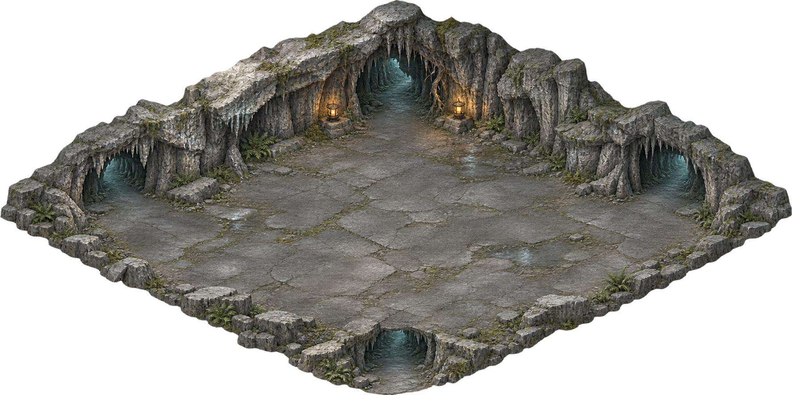

# 바람 동굴 디자인과 구현

먼저 생성한 완성 장면을 동굴의 재료·형태·광원 기준으로 사용합니다.



회색 석회암의 층과 균열, 넓고 읽기 쉬운 석재 바닥, 소량의 이끼·고사리,
작은 철제 등불과 차가운 동굴 안쪽 색을 유지합니다. 뒤쪽 암벽은 높게, 앞쪽은 낮은 돌턱으로 잘라 전투 공간을 드러냅니다.
게임은 기준 장면에서 파생한 실제 생성 원화를 사용하며 코드로 바위·바닥·등불 그림을 대체하지 않습니다.

## 원화와 재생성

- `assets/source/cave-design.png`: 완성 장면 기준.
- `assets/source/cave-kit.png`: 바닥·바깥 암석 텍스처, 양 방향 높은 암벽, 바위 모서리, 등불.
- `assets/source/cave-ledges.png`: 양 방향 앞쪽 돌턱.
- `assets/source/cave-arches.png`: 실제로 열린 통로 아치 두 방향과 숲 쪽 동굴 입구.
- `tools/extract/cave_art_measure.json`: 원화 영역·지면 접점·통로 폭·카메라 보정의 실측값.
- `assets/data/cave_art.json`: 실제 배포 원화 좌표와 기준 이미지·원본·런타임 WebP의 해시.

```sh
python3 tools/prepare_cave_art.py
python3 tools/extract/extract_data.py /path/to/sjrpg --only=village
tools/check.sh --only=dungeon,dungeon_art --export
```

패킹은 여백 정리와 균일한 축소만 수행합니다. 바닥은 정사각 원화를 지면 두 축 ±30°로 투영하고,
암벽·돌턱은 실제 접점선에 맞춘 작은 전역 보정을 적용합니다. 불규칙한 암석 능선을 건물의 직선 모서리 각도 인증으로 대신하지 않습니다.
긴 사선 원화의 전체 높이와 바위 자체의 수직 높이를 구별해 앞·뒤 벽의 크기를 정합니다.
통로 아치의 구멍은 투명하며 내부 캐릭터와 바닥을 표시합니다. 숲 입구의 깊은 동굴 내부는 원화로 유지합니다.

## 지형과 표시

`DungeonArt`는 기존 `DungeonLayout`의 바닥을 그대로 사용합니다. 다섯 전투 구역·두 갈림길·22마리 적·5분 제한과 보상 규칙은 유지합니다.
겹치는 방·통로의 합집합에서 바깥 경계만 구해 내부 접합부에 암벽이 놓이지 않게 합니다.
암벽은 원래 비율을 유지해 조각 전체를 균일하게 축소·반복합니다. 능선 중간을 잘라 얇은 돌출이 생기지 않게 합니다. 가까운 통로의 벽은 낮춰 전투방을 가리지 않게 하고,
높은 사선 암벽은 작은 띠로 나눠 각 지면 접점에서 정렬하므로 등불·배우를 잘못 덮지 않습니다.
앞쪽 돌턱·암벽·아치는 월드 깊이 정렬과 캐릭터 가림 완화를 사용합니다.
바닥·충돌·미니맵·확대 지도는 같은 투영 다각형을 공유합니다.

등불은 생성 원화에 실제 지역 조명을 더하며 탐험 중 작은 밝기 변화를 표시합니다.
일시정지와 동작 줄이기에서는 흔들림을 멈춥니다. 바닥에 별도의 고정 검은 그림자를 얹지 않습니다.
동굴 원화와 조명은 임시 동굴 루트 아래에 있어 화질 전환·퇴장·재입장에 함께 이동하거나 정리됩니다.

## 검수

`dungeon_art`는 기준·배포 픽셀의 해시, 실제 바닥·지도·외곽벽 일치, 깊이 정렬, 등불 움직임·일시정지,
두 화질의 동굴 수명과 숲 복원을 검사합니다. 기존 `dungeon`은 갈림길 이동·전투·완료·시간 종료·사망·재접속을 검사합니다.

`node tools/screenshot.mjs --scene cave_room --device phone-landscape`로 전체 방을,
`phone`으로 가까운 재료와 캐릭터 크기를 확인합니다. `cave_entry`·`cave_branch`·`cave_exit`는 입구·갈림길·귀환문을 검수합니다.
이 미리보기는 실제 입장 경로를 거친 뒤 지정 구도에서 멈추며 적·능력치·완료 상태를 변경하지 않습니다.
