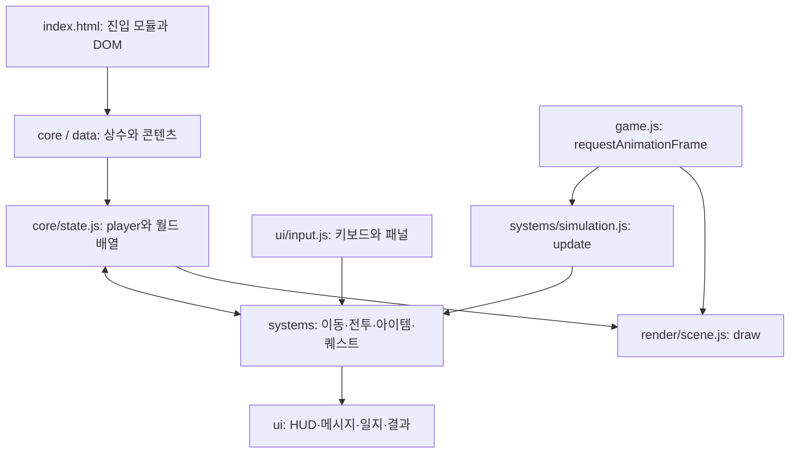

# 두 버전의 개발·배포

`flutter_game/`는 Flutter 3.47.8·Bonfire 4의 새 게임입니다. 루트 `src/`와 `index.html`은 기존 JavaScript 게임으로 유지합니다. 배포 시 루트는 선택 화면, `/sjrpg/legacy/`는 기존 게임, `/sjrpg/new/`는 새 게임입니다. 아래 JavaScript 구조·동작 계약은 기존 버전에 적용합니다.

## Flutter 게임

- `lib/world_model.dart`: 연속 지형 윤곽·수목 몸체·안전 스폰·최대 6px 이동 스윕·제한된 지역 경로 탐색입니다. 주인공·적이 같은 모델을 사용하며 비행·통과 능력을 임의로 부여하지 않습니다.
- `lib/rpg_model.dart`: 직업·24종 장비 템플릿·획득 인스턴스·희귀도·옵션·경험치 레벨·전사 스킬 20종·마법사 스킬 18종·포인트·네 사용 슬롯의 정의입니다. 스테이지는 성장 모델과 분리한 `WorldStage`로 관리하며 처치 수나 레벨만으로 이동하지 않습니다. 장비는 고유 일련번호로 소유를 확인하고 장착 장비 판매·다른 직업 무기 장착·음수 구매를 거부합니다.
- `lib/adventure.dart`의 `EnemyTrait`는 철갑(체력 1.8배)·신속(체력 1.35배/이동 1.2배)을 정의합니다. 첫 무리는 일반 적만 생성하고 18처치·3레벨 이후 성공한 세 무리마다 정예 후보를 한 번 배치합니다. 살아 있는 정예는 최대 하나이며 보스에는 특성을 적용하지 않습니다. 몸체·길찾기·공격 예고/피해·기절 규칙은 일반 적과 같습니다. 발밑 고리·체력 막대/기호·미니맵으로 구분하고 처치 수 1/경험치 30/골드 20/희귀 무기 하나를 지급합니다. 일반 처치 보상 주기와 겹쳐도 장비는 하나만 생성하고 보상 중복 방지는 기존 사망 가드를 따릅니다. 일반 적과 마찬가지로 멀리 벗어나면 정리하며 체크포인트에서는 주변 무리를 다시 구성합니다.
- `lib/spell_vfx.dart`: 생성형 4×4 아틀라스를 실제 프레임으로 재생합니다. 운석 비행 8프레임/0.65초, 충돌 8프레임/0.56초, 얼음 생성·파쇄 16프레임/0.72초, 소용돌이 16프레임/0.5초, 함성 16프레임/0.64초이며 셀 안쪽 1px로 잘라 인접 프레임 누출을 막습니다. 지면 폭발은 배우 아래의 우선순위 29에 그려 캐릭터를 가리지 않으며 공격 반경에 맞춰 크기를 제한합니다. 파편은 별도 속도·회전·중력, 얼음 갑옷은 굴절 결정·광택, 함성과 소용돌이는 변하는 벡터 파동·궤적을 그립니다. 효과 시간은 시뮬레이션을 따라 일시정지 때 멈춥니다. 소용돌이는 렌더 때의 주인공 위치까지 보정해 이동 중 뒤처지지 않게 하고 스킬 초기화 때 취소합니다. 소용돌이 피해는 세 차례 펄스로만 적용합니다. 함성 충격파는 시전 위치에 고정되고 그림이 피해를 반복하지 않으며 초기화 때 취소됩니다. 운석 피해 시점·시야·초기화 취소와 서릿발의 즉시 피해/제어는 유지합니다. 근접 실제 적중 때만 30~45ms 타격 자세를 유지하고 적에게 60ms 색상 섬광을 주며 공격/이동/쿨다운은 멈추지 않습니다. 구르기는 자세 유지를 즉시 취소합니다. 카메라 반응은 1.5 월드 픽셀/0.14초로 제한하고 전투/저장/충돌 좌표에는 적용하지 않습니다.
- `lib/battle_effects.dart`: 원소 탄·광신도 투사체의 5px 이동 스윕·첫 지형/대상 판정, 시야를 검사하는 범위 피해·연쇄 번개·지연 유성·소용돌이 3회 타격, 바닥 전리품·상자·지역별 필수 성소 표시입니다. 투사체는 종료 상태를 즉시 기록해 제거 대기 중에도 재타격하지 않습니다.
- `lib/skill_aim.dart`: 유성·대지 강타의 드래그 방향·범위·취소 상태입니다. 버튼을 놓을 때만 자원·재사용 대기시간을 적용하고 짧은 터치는 기존 자동 조준을 유지합니다. 화면 크기·카메라 위치로 목표 지점을 화면 안에 제한하고, 지형 스윕을 공유해 범위 미리보기와 실제 타격 지점이 일치합니다. 패널·포커스 이탈·회피는 미완료 조준을 취소하며 저장하지 않습니다.
- `WorldStage.bossActor`는 지역별 보스 그림을 선택하며 전투 종류·몸체·기존 체크포인트의 `golem` ID는 바꾸지 않습니다. `actors-sand-warden`·`actors-ancient-king`·`actors-cyber-core`는 생성 원본의 8방향·두 보행 자세를 4×4 아틀라스에 포장하고 프레임별 실제 알파 경계를 사용합니다. 석상왕의 남서향 두 자세는 별도 생성 원본에서 가져와 잘못 생성된 방향을 대체합니다. 미래 코어는 원본의 실제 투명 행 간격을 기준으로 잘라 안테나가 잘리지 않게 합니다. 세 아틀라스 모두 셀 안쪽 16px 여백·발 위치를 지키며 인접 셀을 읽지 않습니다. 보스 이름은 148×24px의 어두운 판 위에 그리며 체력바와 일반 적 이름 표시 조건은 유지합니다.
- `lib/game_art.dart`: 공유 생성 이미지·측정 프레임을 읽어 16/8방향 캐릭터·바닥 재질·목교·마을을 표시합니다. 모든 지역은 192px 크기의 공유 재질 텍스처와 `TileMode.repeated`를 사용해 반사 없이 바닥을 이어 붙입니다. `ground_texture.dart`는 숲의 자연 재질 여섯 장을 반 칸 이동한 네 샘플과 가로·세로 알파 가중치로 로딩 시 한 번 접합합니다. 매 프레임 합성 레이어를 만들지 않으며 아틀라스의 다른 재질을 읽지 않습니다. 열두 셰이더를 만든 뒤 두 원본 바닥 아틀라스를 해제합니다. CanvasKit은 필터 품질에 따라 셰이더를 다시 만들 수 있으므로 192px 이미지 핸들은 `images[ground-번호]`로 소유하고 셰이더와 함께 정리합니다. 게임은 작은 바닥 텍스처만 유지하므로 1536×1024 RGBA 원본 두 장에 해당하는 약 12MiB의 상주 이미지 참조를 보관하지 않습니다. 숲의 WebP 바닥 아틀라스는 작은 잔디·이끼·낙엽·수면·흙길로 구성하고, 후속 지역의 바닥 아틀라스는 모래·작은 석재·낮은 금속 판으로만 구성해 장식 벽이나 큰 구조물이 걷는 바닥처럼 반복되지 않게 합니다. 512px 지형 명령 캐시는 최대 24개입니다. 마을 그림의 가장자리 알파 마스크는 로딩 때 한 번만 640×960 텍스처로 만들어 주변 지형에 연결합니다. 프레임마다 합성 레이어를 만들지 않습니다. 그림과 충돌이 같은 월드 데이터에서 나옵니다.
- `lib/adventure.dart`: Bonfire `Player`·`Enemy`·`GameComponent`와 충돌·카메라·키보드 이벤트를 사용합니다. 전체 몸체 지형 스윕은 자연형 맵 모델로 처리하고, Bonfire 충돌이 캐릭터 간 겹침을 해결합니다. 카메라는 판정이 끝난 주인공 좌표를 직접 따라가며 시작의 0초 프레임·회피 중에도 유한 좌표와 화면 중심을 유지합니다. 높이가 짧은 작은 세로 화면에서는 조작 버튼 위로 주인공이 보이도록 카메라를 36px 올려 표시하며 몸체 좌표는 바꾸지 않습니다. 주변 일반 적 무리는 40마리 이내로 관리하고 보스는 별도 생성하며, 먼 일반 적은 보상 없이 정리합니다. 경로는 현재 몸체가 실제로 도달할 수 있는 시작점을 고르고, 모퉁이 노드에 도착한 뒤 방향을 바꿉니다. 유효한 경로는 목표가 이동하거나 다음 구간이 막힐 때까지 유지해 느린 적도 앞으로 나아갑니다. 구르기는 8방향·4포즈 전용 그림을 사용하며 시작 방향을 유지하고 착지 후 누르고 있던 공격을 재개합니다. 대지 강타의 충돌점은 6px 몸체 스윕으로 벽 앞에 고정하고 범위 피해도 시야를 검사합니다. 연속 베기·회전 공격·회피·피격·성장·보스 결과는 시뮬레이션 시간으로 처리합니다. 주인공 피격은 `hurtFlash` 0.12초의 색상 섬광을 사용하고 몸체 알파는 낮추지 않습니다. 기존 0.65초 피해 보호·0.32초 회피·재개 보호 시간은 유지하고 발밑 고리로 보호 상태를 표시합니다. 섬광과 보호 고리는 일시정지 때 멈추며 무시한 피격은 섬광을 다시 시작하지 않습니다. 이동 중 기본 공격의 조준 보조는 공격 방향만 바꾸고 조이스틱 이동 방향을 바꾸지 않습니다. 레벨 3부터 광신도가 0.65초 시전을 예고하고 고정한 목표로 투사체를 발사합니다. 기절은 시전을 취소하며, 발사 후 2.8초 뒤 다시 준비합니다. 각 스킬의 대기시간은 ID별로 유지하며 슬롯을 바꿔도 초기화하지 않습니다. 예전 두 칸 저장은 주/보조를 보존하고 배운 나머지 사용 기술을 3/4칸으로 옮깁니다. 전투 버튼은 원형으로만 터치 판정하며 직업·무기 그림과 내부 대기시간 숫자를 표시합니다. 보스 강타는 고정한 목표 위치를 0.85초 예고하고 지형/거리 검사 후 피해를 주며 기절로 중단할 수 있습니다. 적은 Bonfire 마운트 이후에만 공격 대상으로 삼고, 아직 로딩 중인 적을 원거리 정리하지 않습니다. 렌더링은 피해·스폰·게임 난수를 변경하지 않습니다.
- `HuntEnemy`의 늑대는 75~250px 시야 안에서 0.42초 경로 예고 후 최대 240px를 초당 520px로 뛰어듭니다. 목표를 따라 방향을 바꾸지 않고, 이동은 6px 이하로 분할해 전체 몸체 지형/적 충돌을 확인하며 주인공과 접촉하면 한 번만 공격하고 멈춥니다. 구르기 무적을 존중하고 빗나간 후에는 일반 추적으로 돌아갑니다. 해골은 0.5초 예고 후 고정한 방향의 반각 0.85라디안·100px 범위를 한 번 공격합니다. 피해는 지형 시야를 확인하며 `EnemySwipe`는 0.22초 시각 효과만 담당합니다. 일시정지는 준비/돌진/효과를 멈추고 기절은 공격을 취소해 즉시 재시도하지 못하게 합니다.
- 같은 공격 파이프라인에서 전갈은 0.58초 예고·최대 200px·초당 440px의 돌진(피해 10), 트롤은 0.85초 예고·120px·반각 1.05라디안의 휘두르기(피해 14)를 사용합니다. 미래 검병(`cyber`)은 0.65초 예고·110px·반각 0.95라디안의 베기(피해 10)를 쓰고 2.1초간 회복합니다. 미래 사격 경비병(`gunner`)은 350px 안에서 0.8초 동안 방향을 고정해 푸른 조준선을 충전하고 초당 320px의 광탄(피해 10)을 한 발 발사하며, 광신도는 기존 280px·0.65초·초당 280px의 마법탄을 유지합니다. 광탄도 `ShadowBolt`의 수명·분할 충돌·한 번 피해 계약을 따릅니다. 모든 공격 준비는 기절 시 취소되고 최소 1.2초의 재공격 대기 시간을 얻습니다.
- `lib/boss_attacks.dart`의 `BossAttack`은 시전 때 고정한 원점·목표·체력 구간으로 위험 도형을 생성합니다. 숲은 0.85초/105px 원/피해 24, 사막은 0.95초/3개 원/피해 22, 고대는 1.05초/260px 부채꼴/피해 26, 미래는 1초/교차 광선/피해 24입니다. 사막·고대·미래는 체력 절반 아래에서 다음 시전부터 5개 분출·넓은 부채꼴·8방향 광선으로 강화하고 회복 시간을 줄입니다. 이미 표시한 예고는 도중에 체력이 바뀌어도 바꾸지 않습니다. 도형의 포함 판정과 경로를 공유해 예고와 실제 피해 범위를 맞추며, 보스 원점·위험 도형 중심에서 대상까지 지형 시야가 모두 열려야 한 번만 피해를 줍니다. `BossAttackVisual`은 우선순위 29로 배우 아래에 예고·동적 충격을 표시하고 일시정지 때 멈춥니다. 기절·사망은 준비를 무효화하며 충격 효과 자체는 피해를 재발동하지 않습니다. 체크포인트는 보스의 체력·위치를 유지하고 중단된 예고는 복원하지 않습니다.
- `Adventure.nearbyAction`은 탑승 중 하차, 미완료 성소, 상자/출구/탑승을 확인하고 상점·현자가 동시에 가까우면 더 가까운 주민 하나를 선택합니다. `main.dart`는 조이스틱 위에 폭 120px 버튼 하나만 배치해 네 스킬·물약 영역을 침범하지 않습니다. 가방 배지는 확인 전 장비 수, 스킬 배지는 남은 포인트입니다.
- `lib/main.dart`·`class_selection.dart`·`game_ui.dart`·`game_panels.dart`·`rpg_widgets.dart`: 360도 조이스틱·두 손가락 조작·컨텍스트 상점 버튼·직업 선택·HUD·보스 몸체 체력/예고·물약·장비 DPS 비교/판매·사용 스킬 4칸 투자/지정·일지/지도·설정·결과 창입니다. 다음 지역이 있는 승리 화면은 `stageCleared`일 때만 하단 고정 주 행동으로 다음 의뢰를 제공하고, 계속 탐험은 본문 보조 행동으로 둡니다. 현재 마지막 두 지역은 계속 탐험을 고정 주 행동으로 유지합니다. 직업 선택은 생성한 청록/황동 팝업 그림을 사용하고, 게임 패널은 얇은 테두리·둥근 모서리의 모바일 시트로 표시합니다. 세로 화면에서는 아래쪽에 정렬하며 제목과 복귀 버튼은 고정합니다. 미니맵은 가장자리에서도 주인공이 중앙인 2,100×2,100의 주변을 따라가며 적·미개봉 상자를 표시하고, 여정 지도는 전체 월드를 표시합니다. 살아 있고 등장한 보스는 붉은 마름모로 표시하며 미니맵 범위를 벗어나면 가장자리에 방향을 고정하고 큰 지도에는 실제 위치와 이름을 그립니다. 주인공 표식은 보스보다 나중에 그려 중앙 가시성을 유지합니다. 처치 수는 여정/결과에 남기고 HUD의 골드·시간 행에서는 제외합니다. 미니맵 탭은 별도 큰 지도를 열고 게임을 멈춥니다. `world_map.dart`는 확대·드래그·내 위치·전체 보기와 복귀를 제공합니다. 시작·이어하기·지도 도구/복귀·로드 재시도 버튼도 공통 `GameAction`의 50px 조작면과 청록/금색 스타일을 사용합니다. 지도 확대/축소는 48×50px로 유지합니다. 패널·포커스 이탈 시 입력을 해제하고 게임을 멈춥니다. 팝업 동안 뒤쪽 게임 캔버스와 HUD의 접근성·포인터 입력을 제외하고 게임의 키보드 초점도 제외해 팝업 조작을 가로막지 않게 합니다. 최초 모바일 높이를 유지하며 게임 영역은 연속 탭 확대를 허용하지 않습니다.
- `lib/skills_panel.dart`·`lib/skill_tree.dart`: 직업별 3계열 탭과 선행 기술 연결선을 표시합니다. 전투 슬롯 4칸·투자/설명 버튼·복귀 버튼을 고정하고 트리 본문만 스크롤합니다. 넓은 가로 화면에서는 투자와 복귀를 한 줄로 합쳐 트리 높이를 확보합니다. 노드를 누르면 짧은 화면에서도 선택 노드가 보이도록 본문을 부드럽게 맞춥니다. 추가 지속 기술은 별도 생성형 아틀라스를 사용합니다. 노드 선택 후 바로 투자할 수 있으며 설명/배치는 별도 상세 보기로 제공합니다. 상세 보기 동안 뒤쪽 위젯의 접근성·키보드 초점을 제외합니다. `SkillDef.requires`는 같은 직업/계열의 선행 기술 ID와 등급을 정의하고 트리 깊이·연결선·조건 설명에 공통으로 사용합니다. `Progress.canLearn`은 레벨/포인트/최대등급/선행 조건을 검증하고 실패 때 포인트를 쓰지 않습니다. 기존 저장의 이미 배운 기술은 선행 조건이 새로 생겨도 사용/강화를 허용하며 초기화 후 첫 습득부터 새 조건을 적용합니다. 카탈로그의 참조·등급·계열·비순환 조건을 검사합니다. 전투 집중은 기본 공격 간격, 전장의 맹세는 최대 생명/다음 함성 보호 시간, 고양의 울림은 보호 중 실제 적중 한 번당 분노, 온기는 실제 마나 회복, 냉기/번개 숙련은 해당 기본 무기 및 서릿발/연쇄 번개 피해에 적용합니다. 초기화는 확인 뒤 50골드/실제 투자량을 검증하고 무료 기본/시작 기술만 남기며 `buildRevision`으로 이전 자기 투사체·유성·소용돌이 후속 피해와 남은 물리 행동을 취소합니다. 장비/경험치/처치/재사용 대기시간은 보존합니다.
- 전투 대상은 `Progress.basicTargetLimit`·`skillTargetLimit`을 기준으로 선택합니다. 근접 기본 1~5명, 마법 기본은 3등급부터 폭발 포함 3~5명입니다. 사용 광역기는 3명에서 시작해 기술별 최대 5/7/11명으로 자랍니다. `areaStrike`는 거리·시야·생존 상태를 확인하고 가장 가까운 대상부터 제한합니다. 소용돌이는 시전별 `castTargets`로 세 펄스가 같은 고유 대상 예산을 공유하며, 폭발 탄은 직접 맞은 대상을 보조 피해에서 제외합니다. 체력은 일반·정예·보스의 생성 시 기본값을 두 배로 적용하고 기존 레벨/정예 배율을 유지합니다. 무리 리젠은 기본 10초/최소 8초, 초기 6마리·초반 8마리·이후 10~12마리이며 정상 적 최대 40마리와 별도 보스를 유지합니다.
- `questSites`는 뿌리 우물·달빛 샘·태양 제단의 ID/위치/몸체/색을 정의합니다. `cleansedSites`에 완료를 기록하고 근거리·시야·주변 적 부재를 검증한 뒤 한 번만 보상합니다. 세 곳과 처치 목표를 채워야 보스가 등장하며 `stageCleared`는 필수 성소와 보스 완료를 함께 요구합니다. 같은 정의를 충돌 예약·미니맵·저장·여정·월드 그림에 사용합니다. `quest_routes_test.dart`는 도보 28×24와 지상 탈것 40×32 몸체로 네 지도의 17개 필수 지점까지 연결 경로를 찾고, 각 구간을 실제 `world.move`로 따라가며 조사 거리·시야도 확인합니다. `Trail.bounds`로 먼 길의 검사·그리기를 건너뛰고 새 외곽의 호수·사구·숲·다리와 상자 접근로는 전체 도보/탈것 몸체로 통과를 검사합니다.
- `TravelMount`는 레거시의 `actors-vehicles` 8방향/두 동작 그림을 공유합니다. 자동 접촉 탑승은 없으며 버튼으로 타고 내립니다. 지상 탈것은 지상 전체 몸체 판정을 사용하고, 배는 충분한 물이 있는 곳에만 생성하며 수면 몸체 검사/분할 이동으로 육지·고정 장애물을 통과하지 못합니다. 하차는 장애물을 가로지르지 않는 인근 육지를 찾고 없으면 탑승 상태를 유지합니다. 전투/회피 입력은 먼저 하차를 시도합니다. 실수로 비행·지형 통과 권한을 주지 않습니다.
- `lib/skill_preview_model.dart`·`lib/skill_preview.dart`: 실제 장비·레벨·배운 등급을 기준으로 현재/다음 등급의 피해·주요 능력치를 비교합니다. 미리 보기는 독립된 등급/장비 참조 사본만 읽고 원본 장비·포인트·골드·저장을 변경하지 않습니다. 최대 등급에서는 다음 열을 숨깁니다. 기본 공격과 사용 기술 피해는 `Progress.skillDamage`, 보호율은 `skillProtection`, 함성 시간은 `warcryDuration`, 실제 적중 분노는 `rageOnHit`를 전투와 함께 사용합니다. 회전 피해는 세 펄스 중 한 번, 번개 피해는 감쇠 전 첫 대상 기준입니다. 적 방어·강타·일시적 강화는 표시 기준과 구분합니다.
- `lib/equipment_panel.dart`: 가방·상점은 고정 헤더/분류 탭/복귀 버튼 사이의 단일 목록입니다. 최근 획득 장비부터 기본 비교 수치와 바로 장착 버튼을 표시하고, `Progress.previewBasicAttack`은 원본을 변경하지 않는 장착 가정으로 스킬·원소·레벨·부적 공격속도까지 반영합니다. 누른 항목 안에 나머지 옵션·잠금·판매를 펼칩니다. 중첩 상세 창은 사용하지 않으며 가방·상점의 스크롤 컨트롤러를 각각 유지합니다. 착용 부위를 누르면 현재 장비를 목록 앞에 고정해 펼칩니다. 신규 탭은 진입 때 `unseenGear`를 스냅샷으로 보관해 확인·장착 중에 행이 사라지지 않게 하고, 잠금 탭에서 해제한 선택 장비도 접기 전까지 유지합니다. 확인/장착/판매 때 신규 표시를 지우며 중복 골드 전환은 신규 수를 늘리지 않습니다. 상점의 빠른 구매는 구매와 장착을 한 번에 실행하고 동일한 기본 장비를 이미 착용했다면 중복 실행도 거부합니다. 펼친 항목에서 보관 구매를 따로 선택할 수 있습니다. 장비 구매는 `Adventure.buyGear`의 골드·용량·직업·레벨별 재고·제시 가격 검증을 따르고 물약·축복은 바로 구매합니다. `Gear.locked`는 소유 인스턴스에만 설정하고 `Progress.sell`에서 판매를 거부하며 장착·교체는 허용합니다. 저장에 `locked`가 없는 기존 장비는 잠금 해제로 읽습니다. 버튼과 행의 접근성 경계는 분리해 주변 설명이 버튼 이름에 합쳐지지 않게 합니다.
- `lib/shop_content.dart`의 `ShopGearOffer`는 장별 재고 품질·가격·읽기 전용 비교 장비와 실제 구매 생성을 함께 정의합니다. 숲/사막/고대·미래의 재고 단계는 0/1/2이며, 가격은 기본값의 1/3/5배, 무기 공격 옵션은 0/3/6, 방어구 생명 옵션은 0/10/20, 부적 생명·자원 옵션은 0·0/5·4/10·8입니다. 숲은 일반, 이후는 마법 등급이며 상점 무기에 희귀 특수 능력을 부여하지 않습니다. 장비의 자원 비교는 현재 직업에 맞춰 분노/마나로 표시합니다. 미리 보기는 장비 일련번호·재화·저장을 바꾸지 않고, 구매는 현재 지역의 가격을 다시 계산해 오래된 제시 가격을 거부합니다. 빠른 장착의 중복 방지는 기본 종류·희귀도·모든 옵션을 비교하므로 이전 장에서 산 같은 종류의 일반 장비도 상위 마법 장비로 교체할 수 있습니다.
- `lib/settings_controls.dart`: 설정 카드의 `GameSettingToggle`은 행 전체의 터치·키보드와 켜짐/꺼짐 접근성 상태를 제공하며 지원하지 않는 기기에서는 비활성화합니다. 설치 안내의 `GameNoticeDialog`는 화면 높이 안에서 본문만 스크롤하고 확인 버튼을 고정합니다. 전체화면·진동 확인·앱 설치·여정 지도·결과/설정의 새 모험 버튼은 공통 `GameAction`을 사용합니다. 장치 API·저장·설치 이벤트 처리는 기존 브리지를 유지합니다.
- `lib/audio_settings.dart`·`audio_bridge*.dart`·`audio_profile.dart`: WASM 호환 Web Audio로 짧은 음높이 변화와 대역 필터 잡음을 합성합니다. Flutter 엔진이 키 입력의 전파를 중단하므로 `window` 캡처 단계에서 첫 실제 포인터/키 입력을 받아 컨텍스트를 열고, 잠긴 동안의 소리를 나중에 재생하지 않습니다. 무기 원소·성공한 기술·실제 적중·피격·전리품만 해당 이벤트에서 재생하며 쿨다운/자원/일시정지로 거부한 동작은 조용합니다. 같은 소리 80ms·다른 소리 25ms 제한과 최대 12개 소스, 소스 종료 시 노드 해제로 몰이 전투의 중첩을 제한합니다. 피격은 다른 소리보다 우선합니다. 음소거는 별도 브라우저 키에 저장하고 일시정지·사망·승리·종료·숨김 때 소스를 중단합니다. 숨김 때는 컨텍스트도 정지하며 다음 입력에서 다시 엽니다. 소리/기기 API 실패는 전투 수치에 영향을 주지 않습니다.
- `lib/device_settings.dart`·`device_bridge*.dart`·`device_controls.dart`: WASM 호환 JS interop으로 전체화면·진동 지원 여부를 확인합니다. 전체화면 상태는 브라우저 이벤트를 따르며 실패 시 UI에 알립니다. 진동 설정은 Legacy와 별도 키로 저장하고, 피드백은 100ms 간격으로 제한합니다(플레이어 피격 우선). 일시정지·백그라운드·세션 종료 시 진동을 취소하고 장치 오류가 전투를 중단하지 않게 합니다. 실제 진동 모터 여부는 브라우저에서 확정할 수 없습니다.
- `game_checkpoint.dart`·`save_bridge*.dart`: 버전 1 체크포인트를 `guardian.new.progress.v1`에 5초마다, 패널 전환·백그라운드·페이지 종료 때 저장합니다. 레벨·장비 일련번호/장착/신규 확인 상태·스킬/대기시간·물약·상자·이야기 보상·필수 성소·탑승 및 주차 위치/방향·위치·전리품·보스 체력을 복원합니다. `balance: 2`는 이전 살아 있는 보스의 현재/최대 체력을 한 번만 두 배로 이관하며, 기존에 이미 클리어한 저장은 필수 성소도 완료한 것으로 읽습니다. 예전 버전 1 저장의 `unseenGear` 누락은 빈 목록으로 읽고 외부 장비 일련번호나 중복 표시는 거부합니다. 일반 적 무리는 다시 구성하고 막힌 위치는 안전한 몸체 위치로 보정합니다. 잘못된 형식·외부 아이템/스킬 ID·중복 장비·비정상 수치는 이어하기 대신 새 모험을 허용합니다. 사망 상태는 마지막 살아 있던 체크포인트를 덮어쓰지 않습니다. 사망 화면의 재도전은 저장을 지우지 않고 새 세션을 복원합니다. 새 모험으로 돌아갈 때 종료 저장이 기존 진행을 되살리지 않게 저장을 해제한 뒤 삭제합니다.
- `install_bridge*.dart`·`install_controls.dart`·`web/install.js`: 초기 `beforeinstallprompt`를 전역 게임 상태 없이 클로저에 보관합니다. 설정의 설치 요청은 사용자 탭 안에서 전달하고 취소·기설치·iOS 수동 추가를 안내합니다. 매니페스트 ID·시작 경로·서비스 워커 범위는 `/sjrpg/new/`로 고정합니다.
- `scripts/prepare-new-assets.cjs`: 공유 WebP와 `flutter_game/art/`의 운석·얼음 WebP 아틀라스 및 마법사·구르기·회피 아이콘·전투 효과 PNG 및 바닥 재질 WebP와 측정된 프레임 메타데이터를 `flutter_game/assets/`에 준비합니다. 이 생성 폴더와 Flutter 빌드 산출물은 Git에 추가하지 않습니다. 준비 스크립트는 이전 `terrain-materials.png` 생성 파일을 제거해 WebP와 함께 중복 배포되지 않게 합니다. 한글 글꼴은 로컬로 포함한 Nanum Gothic(OFL)입니다.

Flutter 변경은 `dart format --output=none --set-exit-if-changed lib test`, `flutter analyze`, `flutter test`, 실제 브라우저의 입력·팝업·전투로 확인합니다. 테스트의 모델·대체 엔진 검사를 실제 웹 렌더링 검증으로 보고하지 않습니다. 현재 새 버전은 전사/마법사·장비·스킬 성장과 제1장→제2장→선택한 제3장 범위입니다. 필수 성소 3곳의 정화와 120마리 처치 후 보스 토벌은 첫 정화 결과를 열며, 계속 탐험하면 적 무리의 추가 보충 없이 남은 전리품과 상자를 찾습니다. 동서남북 출구는 제거했으며 의뢰 완료 후 결과/여정 화면에서 다음 지역으로 이동합니다. 피해 숫자는 최대 14개, 획득/안내 말풍선은 최대 2개로 제한합니다. 선택 여정 `stageMemories`는 세 상자의 개봉 기록으로 이야기 조각을 해금하고 완성 시 스킬 포인트 1개를 한 번만 줍니다. 분수는 비전투 상태에서만 회복시키고 일반 적의 물약 보충은 처치 12/14마리 주기입니다. 물약·자원 부족 안내는 캐릭터 주변 말풍선으로 표시합니다. 레벨업은 캐릭터 위 숫자와 짧은 빛, 메뉴 배지로 알리며 중앙 메시지를 띄우지 않습니다. 사용하지 않는 이전 바닥·UI 참조 그림은 로딩하지 않습니다. 기존 전체 기능 포팅은 포함하지 않습니다.

## 배포 조립

`npm run build:legacy`는 기존 게임만 `.build-cache/legacy/`에 만듭니다. `npm run prepare:legacy`는 현재 소스와 바이트 단위로 같은 캐시나 공개 Legacy 배포본을 복원합니다. 어느 쪽도 맞지 않을 때만 Legacy를 독립 빌드합니다. `scripts/build.cjs`의 `describeSite()`가 원본 목록·해시·배포 바이트를 공통으로 정의합니다. 복원은 임시 폴더에서 모든 다운로드와 검증이 끝난 뒤 교체합니다. Node 24의 `--use-env-proxy`로 관리형 환경의 네트워크 설정을 따릅니다.

Flutter는 `flutter build web --wasm --release --base-href /sjrpg/new/ --no-web-resources-cdn`으로 독립 빌드합니다. GitHub Pages의 헤더 제약에 맞춰 `forceSingleThreadedSkwasm`을 사용합니다. 지원 브라우저는 `main.dart.wasm`·Skwasm을 로드하고 미지원 브라우저는 Flutter가 함께 만든 JS/CanvasKit 빌드로 실행합니다. `dart:html`을 쓰지 않고 `dart.library.js_interop` 조건부 구현과 `package:web`을 사용합니다. 모바일 진입 높이는 고정하되 실제 `fullscreenchange` 동안만 100dvh를 적용하고 종료 시 원래 높이를 복원합니다.

`npm run build`는 이미 준비된 `flutter_game/build/web/`와 `.build-cache/legacy/`를 복사해 `dist/`를 조립하며 두 게임을 컴파일하지 않습니다. WASM/MJS/JS 산출물이나 Legacy 진입점이 없으면 거부합니다. Flutter 산출물 해시로 `new/releases/<해시>/`를 만들고 `new/index.html`의 base를 설정합니다. 기존 게임은 자체 해시를 유지합니다. 앱 설치용 `manifest.webmanifest`·`sw.js`·`icons/`는 `/new/`의 고정 경로에도 복사합니다. 서비스 워커는 `/sjrpg/new/` 탐색만 네트워크에서 새로 가져오고 게임·그림·스크립트를 캐시하지 않습니다. 오프라인 플레이는 제공하지 않습니다. `site/index.html`은 두 개의 짧은 링크만 배치한 스크롤 없는 버전 선택 화면입니다. 새 게임 링크에는 해당 Flutter 산출물의 버전 쿼리를 넣어 이전 진입 HTML 캐시를 피합니다.

GitHub Actions의 **Check and deploy**는 `legacy`·`flutter` 작업을 분리하고 각각 콘텐츠 키로 캐시합니다. Flutter만 바뀌면 Legacy를 다시 빌드하지 않으며, 선택 화면만 바뀌면 두 게임의 빌드 캐시를 재사용합니다. `assemble` 작업은 두 산출물을 받아 Pages 파일로 묶습니다. 완료 보고 전 해당 커밋의 배포 성공과 공개 페이지에서 WASM 리소스·전체화면·진동 API·두 하위 경로 로드를 확인합니다. 진동 API 호출 검증을 실물 기기 진동 검증으로 보고하지 않습니다.
Flutter 월드는 46,080×34,560입니다. 시작 마을과 기존 지형을 보존하고 외곽의 긴 분기 길·순환 길·숲·큰 사구·나무 없는 초원·31개 상자를 배치합니다. 분노의 기본 획득량은 기본 공격 한 번의 적중당 3, 피격당 7이며 헛스윙은 자원을 주지 않습니다. 고양의 울림은 함성 보호 중 실제 적중의 획득량에만 추가됩니다. 전투 이펙트는 `flutter_game/art/combat-fx.png`의 생성형 아틀라스를 재사용하고 전투 판정은 기존 모델이 담당합니다.

---

# 개발 참고

후속 AI 개발을 위한 현재 구조와 동작 계약입니다. 작업 지침은 [AGENTS.md](../AGENTS.md)를 먼저 읽고, 문서의 설명은 실제 코드와 대조합니다.
리뷰 이력이나 완료 기록 대신 현재 구현을 기술합니다.

## 프로젝트 구조

```text
.
├── index.html                 # DOM 패널·진입 모듈·초기 높이 고정 스크립트
├── style.css                  # HUD·패널·시작/결과 화면 스타일
├── playful-pixels.mp3         # 배경음악
├── AGENTS.md                  # AI 개발 지침과 참고 문서 진입점
├── docs/development.md        # 현재 구조·동작 계약·검증·배포
├── src/
│   ├── core/                  # 상수·상태·충돌·Canvas·카메라·모바일 높이 고정
│   │   └── preferences.js     # 소리·진동 설정의 검증·기기 저장
│   ├── data/                  # 콘텐츠 정의와 거리별 적 선택 규칙
│   ├── systems/
│   │   ├── simulation.js      # 프레임별 게임 업데이트 순서
│   │   ├── world.js           # 맵 생성·연결성·타일 조회
│   │   ├── spawning.js        # 적·보스·NPC·초기 배치
│   │   ├── player.js          # 이동·공격 입력·캐릭터 타이머
│   │   ├── combat.js          # 공격·피해·처치·단계 진행
│   │   ├── enemy-ai.js        # 적 상태 머신
│   │   ├── pathfinding.js     # 상태를 참조하지 않는 A* 탐색 엔진
│   │   ├── navigation.js      # 몸체·장애물 판정·경로 캐시·생성 위치 접근성
│   │   ├── entities.js        # 드롭·상자·투사체·장판·효과의 생성/업데이트
│   │   ├── environment-effects.js # 시뮬레이션 시간 기반 분수·안개 파티클 생성
│   │   ├── mounts.js          # 탈것 생성·하차
│   │   ├── consumables.js     # 소비 아이템 사용
│   │   ├── auxiliary-weapons.js # 보조무기 선택·사용
│   │   ├── quests.js          # 수락 가능 여부·진행·보상·클리어 판정
│   │   ├── travel.js          # 포탈·편도 지역 이동
│   │   ├── audio.js           # Web Audio 효과음·MP3 재생
│   │   └── feedback.js        # 타격·피격 진동 및 연속 진동 제한
│   ├── ui/                    # 키보드·터치 조작, 인벤토리·상점·대화·도감·HUD·일지·메시지
│   ├── render/                # Canvas 지형·엔티티·효과·미니맵·시작 화면
│   └── game.js                # DOM 이벤트 초기화·게임 시작·프레임 루프
├── scripts/
│   ├── build.cjs              # 배포용 정적 실행 파일을 dist/에 구성
│   ├── page-sources.cjs       # HTML 진입점과 import/export 그래프 공통 로더
│   └── check.cjs              # 소스 누락·문법·HTML 참조·ESLint 검사
├── tests/
│   ├── game.test.cjs          # 실제 게임 코드를 실행하는 회귀 테스트
│   ├── navigation.test.cjs    # A*·몸체 접근성·보조무기 획득·모듈 격리 검사
│   ├── viewport.test.cjs      # 모바일 진입 높이 고정 검사
│   └── helpers/game-harness.cjs # DOM·Canvas·타이머를 대체하는 VM 환경
├── .github/skills/            # 콘텐츠 추가·디버깅 작업 지침
└── .github/workflows/check.yml # push/PR 검사·main의 GitHub Pages 배포
```

## 아키텍처

게임 코드는 ES Modules의 명시적 `import/export`로 연결됩니다. `index.html`에서는
초기 높이 고정 스크립트와 `type="module"`인 `src/game.js` 진입점만 로드합니다.
각 파일의 변수·함수는 모듈 범위에 있고 다른 파일에서는 필요한 공개 기능을 import합니다.
런타임 의존성은 브라우저 API뿐이며 번들링은 필요하지 않습니다.

변경 가능한 화면·진행 상태와 타일 맵은 `core/state.js`의 `session` 객체에 모았습니다.
플레이어·월드 배열도 해당 상태 모듈에서 export합니다. DOM 초기화는 모듈 로딩 완료 시점의
`document.readyState`를 확인하여 시작 버튼 이벤트를 연결합니다.



`player`, `inventory`, `session`, 월드 엔티티 배열은 import로 전달되는 공유 상태입니다. 시스템은 이 상태를 변경하고,
렌더러는 현재 상태를 Canvas에 그립니다. 패널은 DOM으로 표시합니다.
`update()`는 화면 그리기와 분리돼 테스트에서 독립 실행할 수 있습니다.
`gameLoop()`가 시간 계산, 업데이트, 화면 그리기를 담당하며 종료·일시정지 상태도 그릴 수 있습니다.
화면 크기 변경 시 Canvas 크기·카메라·재그리기 연결도 진입점에서 담당하며 Canvas 모듈은 렌더러를 import하지 않습니다.
렌더링 함수는 월드 엔티티를 생성하지 않습니다. 분수·안개 파티클도 시뮬레이션에서 생성하므로 일시정지·종료 중 증가하지 않습니다.
진행 화면의 NPC·상자·탈것·적·플레이어는 표시용 복사본을 발밑 Y 좌표로 정렬해 그리며 시뮬레이션 배열의 순서를 변경하지 않습니다.
`render/forest.js`는 주변 나무 밀도로 연결된 수관·숲 바닥·가장자리 큰 나무를 표시합니다. 큰 수관은 원본 나무 그림의 잎 부분을 겹쳐 그리며 땅 그리기 뒤 별도 단계로 표시합니다.
밀도는 맵 참조·`terrainRevision`으로 갱신하고, 그림 캐시는 최대 1024개로 제한합니다. 렌더링은 타일·엔티티·게임 난수를 변경하지 않습니다.
숲의 연결성 정리에서는 나무 사이의 접근 불가 빈틈을 덤불로 메웁니다. 실제 물과 사막의 기존 정리는 유지하고 변경 시 `terrainRevision`을 갱신합니다.
`render/presentation.js`는 정적인 지역별 가장자리 음영·저체력 붉은 음영·플레이어 방향 표식을 그립니다.
일반 적의 이름·체력바는 피해를 받았거나 공격·피격 상태일 때만, 보스는 항상 표시합니다.
피해 숫자는 이름 위로 띄우고 테두리·크기 변화로 구분하며 `prefers-reduced-motion`에서는 크기 변화를 생략합니다. 렌더링은 게임 난수를 소비하지 않습니다.
HUD는 DOM 요소와 마지막 표시 값을 보관해 달라진 속성만 갱신하며, 독과 이동 속도 효과를 함께 표시합니다.
시스템이 HUD·메시지 함수를 명시적으로 import하며 일부 순환 의존성은 남아 있습니다.
따라서 이벤트 버스나 모든 시스템의 의존성 주입까지 도입한 구조는 아닙니다.
A* 엔진은 게임 상태에 의존하지 않으며 walkability·edge clearance·goal·heuristic을 함수로 전달받습니다.

업데이트는 플레이어 → 게임 시간 기반 지연 동작 → 적 → 투사체 → 장판·드롭·상자 → 효과·카메라 →
회복·시간 제한·상태 이상 → 퀘스트·포탈 순으로 진행합니다.
적의 공격·투사체·함정 상자로 치명적인 피해를 받으면 종료 판정을 우선해 같은 프레임의 후속 회복으로 되살아나지 않게 합니다.

게임 행동은 `canAct()`로 시작·종료·일시정지·인벤토리·생존 상태를 검사합니다.
월드 초기화는 `clearWorldEntities()`와 `WORLD_ENTITY_LISTS`를 사용합니다.
부메랑 같은 게임 지연 행동은 `deferGameAction()`으로 예약하여 일시정지 때 멈추고 지역 이동 때 취소합니다.
공격·헛스윙·피격의 반복 메시지는 출력하지 않습니다. `ui/messages.js`는 획득·회복·중요 안내를
캐릭터의 화면 위치에 맞춘 말풍선으로 최대 2개 표시하고 2.2초 뒤 제거합니다. 화면 밖으로 나가지 않게 제한하며
Canvas 배율·카메라 이동·Visual Viewport를 반영하며 모달보다 아래에 표시합니다. 말풍선 제거·슬롯 연출은 브라우저 타이머를 사용합니다. 배경음악은 HTML audio 요소로 재생합니다.

적·상자·NPC·탈것 생성은 전체 몸체가 들어갈 수 있는 위치를 검사합니다.
지상 적은 중앙 도착 지점에서 해당 몸체 크기로 도달 가능한 위치에만 생성합니다.
명시적으로 비행·위상 이동 능력이 있는 적만 지상 경로 조건에서 제외합니다.
사막 도착 지점은 열린 지형이며 파라오는 전체 몸체로 접근 가능한 공간을 찾습니다. 파라오는 일반 적보다 먼저 생성하며
후보 검색에서 전체 몸체·거리·접근성·점유를 함께 확인합니다. 생성 실패 시 등장 메시지를 표시하지 않습니다.

### 길찾기와 접근성

- 지상 적의 추적·배회·원거리 접근은 직선 경로가 막히면 A*의 4방향 격자 경로로 우회합니다.
- 노드에서는 몸체 전체의 지형·닫힌 상자 충돌을 확인하고, 연결 구간도 8px 이하 간격으로 검사합니다.
- 추적 목표는 플레이어가 있는 타일을 무조건 차지하는 것이 아니라 몸체 간 공격 거리까지 접근하는 것입니다.
- 유효 경로는 최대 0.7초 재사용하며 목표 타일·맵 변경·다음 구간 막힘을 감지하면 다시 탐색합니다.
- 생성 위치 접근성은 몸체 크기·맵·지형 변경·상자 배치를 기준으로 캐시합니다.
- 지나갈 수 없는 좁은 통로는 몸체를 억지로 통과시키지 않습니다. 길이 없으면 정지하고 재탐색합니다.
- 움직이는 적과 플레이어는 실제 이동 충돌로 처리합니다. 여러 적의 통행 우선순위·군집 분산까지 구현하지는 않았습니다.
- 넉백은 8px 이하 단계로 충돌을 검사합니다. 원거리 적의 횡이동은 0.5초마다 고른 방향과 시뮬레이션 시간 기반 속도를 사용합니다.

### 보조무기 구매

마을 상점에서 대회복약(120골드), 얼음 폭탄(150골드), 도발 북(120골드)을 판매합니다.
암시장과 사막 상점에서는 위 세 종류와 벼락(200골드), 독 안개(180골드)를 판매합니다.
구매 시 정의를 복사해 남은 횟수를 개별 관리하며 보조무기 목록에 추가하고 도감에 기록합니다.
처음 획득한 보조무기는 자동 선택됩니다. 소비 아이템 3칸·주무기 인벤토리 12칸과 별도로 보관합니다.

적 투사체와 플레이어 투사체는 이동 구간에서 가장 먼저 만나는 벽 또는 대상을 판정해
빠른 투사체가 작은 적을 지나치거나 벽 너머를 공격하지 않게 합니다.
원거리 주무기의 투사체 수명은 `range / projectileSpeed`로 계산합니다. 전설검의 근접 범위와 투사체 범위는 별도입니다.

### 아이템·피해·결과

- 인벤토리의 Delete·버리기 버튼은 선택 무기를 바닥에 복사해 놓고 슬롯을 비웁니다. 바닥 수명은 120초,
  재습득 유예는 게임 시간 1초이며 장착 중 무기와 정의 템플릿은 변경하지 않습니다.
- `damageEnemy()`의 `stagger: false` 옵션은 지속 피해가 기존 피격 경직을 갱신하지 않게 합니다.
  장판·독의 주기 피해는 넉백도 부여하지 않습니다. 직접 타격·빙결의 기존 우선순위는 유지합니다.
- 덫은 `singleUse` 장판으로 적 하나에 피해·속박을 적용한 뒤 사라집니다. 폭탄은 단발 피해이며,
  화염병의 즉시 피해와 지속 피해는 각각 데이터에 정의합니다.
- 독의 단검의 독은 적별로 지속 시간과 틱을 보관하며 재적용 시 틱 진행을 유지합니다.
  독 처치는 일반 처치 경로를 사용하고 적 배열의 스냅샷을 순회해 처치·단계 스폰 중에도 갱신 순서를 유지합니다.
- 최종 승리는 남은 시간 비율 50% 이상 S, 30% 이상 A, 10% 이상 B, 그 외 C입니다.
  실패 등급은 기존 처치·보유 골드·피해량 점수로 계산합니다. 결과의 골드는 누적 수입이 아닌 보유액입니다.

## 드롭·참고 수치·그림

`systems/boat-waters.js`는 연결된 물 48타일 이상, 배 몸체가 들어가는 2×2 물 영역의 연결 위치 24개 이상과 가로·세로 5칸 이상의 항해 범위를 검사합니다. 초기 배는 이 수역 안에서 기존 전체 몸체·물가 탑승 검사를 통과한 위치에만 생성합니다. 작은 웅덩이·가느다란 물길·분리된 수역의 합산은 허용하지 않습니다.

`systems/loot.js`는 획득 시 중복 무제한 무기를 가치의 20% 골드로 전환하며 알림은 골드 금액만 표시합니다. 새 무기·횟수 제한 무기는 기존 보관·바닥 드롭 경로를 유지합니다.
직접 버린 무기는 `autoSalvage: false`로 재습득을 보존합니다. 콘텐츠의 `reference`는 SRD 원전 정보이고 실제 HP·ATK는 별도 조정치입니다.
[콘텐츠·아트 출처](content-reference.md)에 원전·번역·실시간 변형·생성 이미지 사용을 기록합니다.
`ui/art.js`는 4×4 생성 아이콘을 DOM에, `render/art.js`는 같은 시트를 Canvas에 표시하며 로딩 전에는 기존 몬스터 그림을 사용합니다.
바닥의 2×2 `terrain.webp`는 로드 후 512×512 Canvas에 한 번 축소·대칭 배치해 잔디·흙·모래·돌길 타일에 사용하며 로딩 전에는 절차형 지형을 그립니다.
재질 한 칸이 월드의 8×8 타일에 경계 없이 이어지도록 월드 좌표로 잘라 그리므로 카메라 이동으로 질감이 바뀌지 않습니다.
`data/art.js`는 숲·사막 4×4 월드 시트의 프레임을 정의하고 `render/world-art.js`는 기존 몸체의 발밑에 그림을 맞춥니다.
월드 시트는 네 방향 모험가·주민·시설·주요 적·탈것에 사용하며 이미지 로딩 실패·지연 시 기존 그림으로 실행합니다.
`ancient-dragon.webp`는 고대 드래곤 전용 투명 이미지이며 원본 종횡비와 발밑 위치를 유지합니다. 체력바·이름도 실제 그림 상단에 맞춥니다.
숲 광장의 SAND는 돌길 재질로 표시하고 사막은 모래 재질을 유지합니다. 타일 충돌 속성은 바꾸지 않습니다.
[월드 아트 기준](art-direction.md)에 대표 이미지·시트 배치·지역별 적용을 기록합니다.
`ui/art.js`는 헤더 시트·조작 시트·팝업 프레임을 각각 로드해 준비된 영역에 클래스를 붙입니다. 로딩 전·실패 시 CSS·SVG 조작을 유지합니다.
`data/ui-art.js`의 실제 그림 영역과 `ui/sprite-layout.js`의 배경 위치 계산으로 조이스틱 바닥·손잡이·공격·메뉴를 정렬합니다. 셀 여백을 그림 중심으로 취급하지 않습니다.
공격 버튼은 검 문양 하나만 표시하며 장비 배지를 추가로 그리지 않습니다. 팝업은 생성한 프레임의 9분할 테두리를 공유합니다.
빈 소비 아이템 바와 대상 없는 대화 버튼은 모바일에서 숨기며, 데스크톱에서도 하단 그림 메뉴를 사용할 수 있습니다.
`world-mounts.webp`의 탈것 4종×4방향은 `data/art.js`의 실제 그림 경계를 사용해 잘라 그리고 종횡비·발밑을 유지합니다.
이동 입력은 `player.dir`과 탑승 중 `mount.dir`을 맞추고, 내릴 때 저장한 방향을 재탑승 시 복원합니다. 렌더링은 방향을 변경하지 않습니다.
빌드는 `assets/`의 WebP 파일을 모듈·CSS와 같은 버전 디렉터리에 포함합니다.

## 모바일 높이 고정

터치 중심 기기(`pointer: coarse`)에서는 페이지 진입 시 `window.innerHeight`를 한 번 읽어
`--app-height`에 픽셀 값으로 저장합니다. 최상위 레이아웃과 게임 영역의 높이가
이 값을 사용하므로 주소창이 숨겨지거나 나타나도 높이를 다시 계산하지 않습니다.
터치 기기는 게임 영역을 확대하지 않고 고정 높이 전체를 사용합니다. 데스크톱의 기존 1.5배 확대는 유지합니다.
가로 폭은 계속 화면에 맞추며 데스크톱에서는 기존 창 크기 변경 동작을 유지합니다.
고정은 현재 페이지가 열린 동안 유지됩니다. 화면 회전 후에도 최초 높이를 유지하므로
새 방향의 높이에 맞추려면 페이지를 새로고침해야 합니다.
사용자가 전체화면을 선택한 동안에는 전체화면 높이를 사용하며, 해제하면 원래 고정 높이로 돌아갑니다.
팝업은 게임 화면의 고정 높이·확대 배율과 분리된 최상위 `#popupLayer`에 둡니다.
`ui/popup-layout.js`가 Visual Viewport의 크기·오프셋을 추적하고, 미지원 시 창 크기를 사용합니다.
주소창·회전·전체화면 전환은 팝업 영역만 갱신하며 `--app-height`를 변경하지 않습니다.
높이 변경·회전·재진입의 고정 규칙은 회귀 테스트로 확인했으며 실제 모바일 주소창 동작은 기기 검증이 필요합니다.

`render/weapon-effects.js`는 주무기 16종의 서로 다른 궤적·문양과 원거리 무기별 투사체를 그립니다. 공격 시작 때 복사한 `player.attackVisual`과 `lastAttackCooldown`을 사용하므로 무기가 마지막 사용에서 부서져도 해당 공격의 그림은 유지합니다. 그림은 공격 타이머만 읽고 난수·전투 상태를 변경하지 않습니다. 투사체의 `weaponId`는 표시용이며 판정·수명·피해를 변경하지 않습니다.

### 터치 입력과 모바일 표시

- 거친 포인터가 있는 기기의 게임 영역과 조작부 전체에 `touch-action: none`을 적용합니다. 비활성 버튼·버튼 사이 빈 공간에도 적용하며 조작부의 `dblclick` 기본 확대도 막습니다. 별도 팝업 영역은 세로 스크롤을 유지합니다.

- `ui/touch-controls.js`는 Pointer Events와 포인터 캡처를 사용합니다. 조이스틱·공격 포인터를 별도로 추적해
  이동과 연속 공격을 동시에 처리하고, 다른 손가락을 떼어도 남아 있는 입력을 유지합니다.
- 키보드 `keys`와 `touchKeys`는 분리하고 플레이어는 `isKeyDown()`으로 합쳐 읽습니다. 터치 해제가 키보드 입력을 지우지 않습니다.
  단발 동작은 키보드와 같은 `performInputAction()` 경로를 사용하므로 일시정지·종료·슬롯머신 제한도 같습니다.
- 패널 열기·일시정지·종료·포인터 취소·캡처 해제·포커스 이탈·문서 숨김 시 터치 입력을 해제합니다.
  퀘스트 일지를 직접 열면 `session.questJournalOpen`과 일시정지를 함께 관리하고 닫을 때 해제합니다.
- `pointer: coarse`에서 조작 버튼·HUD·반응형 패널을 표시합니다. HUD·조작 안내는 12~14px,
  팝업 본문은 14~16px를 사용합니다. 인벤토리는 세로 2열·가로 3열이며 설명은 줄임 없이 표시합니다.
  폭 600px 이상·높이 500px 이하의 가로 화면에서 조작 영역의 높이를 줄이고,
  목록은 세로 스크롤을 허용하며 게임 조작 영역만 브라우저 터치 제스처를 막습니다. 패널마다 닫기 버튼을 제공합니다.
- 공격 버튼에는 검 문양과 실제 `attackTimer / lastAttackCooldown`의 원형 게이지를 표시하며 대기 중에도 누르고 있기 입력을 유지합니다.
  보조 버튼에는 남은 횟수·초 단위 대기시간·원형 재사용 게이지를 표시합니다.
  주요 퀘스트 완료 수와 활성 퀘스트는 모험 일지에 모으며, 모바일의 일지는 하단 메뉴에서 엽니다.
  모바일 상단의 장비 요약은 표시하지 않고 장착 정보는 조작 버튼·가방에서 확인합니다. 미니맵 아래에는 현재 지역을 표시합니다.
- `systems/interactions.js`의 대상 선택을 터치 안내·NPC·포탈 상호작용이 공유합니다. 몸체 사이 거리 40px 미만,
  기본 안내는 포탈·NPC·탈것 순으로 선택하고 동일 종류는 가까운 대상을 사용합니다. 직접 터치하면 누른 대상 중에서 선택합니다. 대상이 없으면 터치 버튼을 비활성화합니다.
  탈것은 이동·겹침으로 자동 탑승하지 않습니다. `boardMount()`가 명시적 입력 때 거리·전체 몸체 배치·게임 상태를 검사한 뒤 탑승합니다.
  표시 문구는 ‘상점·대화·이동·타기’처럼 짧게 하고 대상 이름은 접근성 이름에만 포함합니다.
  머리 위 동작은 11px 반투명 태그 하나로 표시하고 Canvas의 중복 안내를 그리지 않습니다. 태그의 실제 누름 영역은 64×44px이며 우하단 버튼·접근성 이름을 유지합니다.
  터치 기기는 Canvas의 짧은 탭(이동 14px 이하)으로 현재 대상의 몸체를 눌러 열 수 있고, 대상 위에도 열기 버튼을 표시합니다.
  이동 드래그·취소·일시정지 중 탭은 실행하지 않습니다.
- 폭 599px 이하의 터치 화면에서는 팝업을 하단에 정렬하고 헤더·복귀 버튼을 고정합니다.
  아이템은 조이스틱 위에, 내리기는 공격 버튼 위에 두어 좁은 화면의 겹침을 줄입니다.
  가방 본문에는 현재 장착 무기·공격력과 사용 중인 보관 칸 수를 표시합니다.
- 대표 이미지의 UI 시트를 초상·원형 프레임·조이스틱·하단 메뉴에 사용합니다. 체력·단계·골드·시간을 상단에, 메뉴를 하단에 모으며 세로 화면의 카메라 기준점을 화면 높이 43%에 둬 조작 영역을 비웁니다.
  공통 `game-window`·`window-header`·`window-body`·`window-footer`와 HTML 내부 SVG 심벌로 프레임·아이콘·닫기 버튼을 통일합니다.
  본문만 스크롤하고 헤더·푸터는 유지합니다. 복귀·재도전 버튼은 푸터, 상점 잔액은 헤더에 두고 화면 안전 영역을 확보합니다.
  상태 효과 영역은 독·스피드 효과가 있을 때만 공간을 차지합니다. 인벤토리의 키보드 열 수는 실제 Grid 열 수를 사용합니다.
- 도감 항목은 기본 버튼이며 상세정보는 고정 푸터에서 표시하고 긴 내용만 별도로 스크롤합니다.
  게임 키 처리기는 버튼의 Space·Enter 기본 동작을 가로채지 않습니다.
- `tests/game.test.cjs`의 터치 회귀는 DOM 이벤트 대체 환경이며, 실제 멀티터치·패널 스크롤·작은 화면 배치는 브라우저에서 별도로 확인합니다.

### 설정과 피드백

- `ui/settings.js`의 설정 패널은 `session.settingsOpen`·일시정지를 함께 관리합니다. 기존 패널이나 슬롯머신을 덮어 열지 않습니다.
- `core/preferences.js`는 진동·음악·효과음의 불리언 값만 저장하며, 저장소 접근이 막혀도 현재 세션에서 설정을 사용합니다.
  이 저장은 모험 진행 저장과 별개입니다.
- 진동은 직접 적중·근접 피격·적 투사체·함정 피격에서 발생하며 장판·독 피해는 진동을 만들지 않습니다.
  적중 진동은 70ms 간격으로 제한하고 끄기·화면 숨김·포커스 이탈 때 즉시 취소합니다.
- 효과음을 끄면 오디오 노드를 생성하지 않습니다. 음악 재생 재시도도 현재 음악 설정을 확인합니다.
- 전체화면은 설정 패널의 버튼에서 브라우저 API를 호출하고, 미지원·거절 시 설정에 안내합니다. 전환 중에는 해당 버튼을 비활성화해 요청 중복을 막고,
  성공·거절 후 다시 활성화합니다. 전환 이벤트에서 Canvas와 카메라를 갱신합니다.

## 검증

Node.js 24 이상이 필요합니다. 런타임 실행에는 npm 설치가 필요하지 않습니다.

```sh
npm ci
npm run check
npm run build
```

| 명령                   | 용도                                                                          |
| ---------------------- | ----------------------------------------------------------------------------- |
| `npm run lint`         | HTML 소스 목록·ID 중복·누락, 문법, 정적 HTML ID 참조, 미정의/미사용 변수 검사 |
| `npm run format`       | Prettier 포맷 적용                                                            |
| `npm run format:check` | 포맷 확인                                                                     |
| `npm test`             | Node 내장 테스트 러너로 게임 회귀 검사                                        |
| `npm run check`        | lint → 포맷 확인 → 전체 테스트                                                |
| `npm run build`        | 모듈 그래프 검증 후 실행 파일만 dist/에 구성                                  |

정적 검사와 테스트는 `scripts/page-sources.cjs`의 동일한 import 그래프를 사용합니다.
소스별로 ESLint를 실행하고 import 경로·named export·HTML ID·미정의 변수·import 대입을 검사합니다.
새 모듈은 사용하는 파일에서 import해야 하며, 진입점에서 도달하지 않는 소스는 검사에서 실패합니다.
회귀 테스트는 Node의 `vm.SourceTextModule`로 실제 모듈을 링크·실행합니다.
테스트 명령에 필요한 `--experimental-vm-modules` 옵션은 npm 스크립트에 포함돼 있습니다.
테스트 시나리오 접근자는 하네스에만 있으며 브라우저의 전역 공간에 게임 변수를 노출하지 않습니다.
동적 HTML ID와 모든 런타임 초기화 문제까지 정적 검사가 보장하지는 않습니다.

VM 하네스는 HTML에 없는 ID 조회에 `null`을 반환하며, 타이틀 초기화부터 시작 버튼 클릭·첫 프레임까지 검사합니다.
빌드 회귀는 이전 UI 코드와 새 HTML의 혼합 오류, 버전 경로의 변경과 전체 모듈의 경로 일관성을 검사합니다.
자동 테스트는 DOM·Canvas·오디오를 대체하므로 실제 화면·사운드 품질을 보장하지 않습니다.
기능 변경 시 관련 브라우저 동작을 확인하고, 확인하지 못한 범위는 완료 보고에 명시합니다.

## 배포

`main`에 푸시하면 GitHub Actions가 의존성을 설치하고 `npm run check`를 실행합니다.
검사를 통과한 커밋의 `dist/` 빌드 산출물을 Pages 아티팩트로 업로드하고 배포합니다. PR에서는 검사·빌드만 실행합니다.
Actions의 **Check and deploy** 워크플로를 수동 실행해 다시 배포할 수도 있습니다.

배포는 루트 `index.html`과 `assets/<콘텐츠 해시>/` 안의 `style.css`, `playful-pixels.mp3`, `src/`로 구성합니다.
HTML·스타일·모듈 중 하나라도 바뀌면 모든 실행 리소스가 새 경로를 사용하므로 이전 브라우저 캐시와 섞이지 않습니다.
모듈 내부 상대 경로는 유지하며 소스 체크아웃은 기존 경로로 바로 실행할 수 있습니다.
개발 도구·테스트·`node_modules`는 배포 파일에 포함하지 않습니다.
모든 리소스는 상대 경로를 사용하므로 `/sjrpg/` 경로에서도 실행됩니다.
저장소 Settings → Pages의 Source는 **GitHub Actions**입니다.

### 고정 마을과 연속 지형

`data/village.js`의 월드 사각형(분수 X−320, 분수 Y−256,640,960)과 지형 마스크를 맵 생성·그림·전투가 공유합니다. 분수·집·상점·수관을 막고 고정 중앙 전투길과 서쪽·북쪽 출구를 보존합니다. 실제 숲 도착 지점은 분수 아래 175px이며 접근성 탐색도 이 길에서 시작합니다. 그림과 충돌을 맞추기 위해 보스 지형 파괴는 생성 지형에서 실행하지 않습니다.
`render/village.js`는 UI·인물 없는 `village-scene.webp`를 월드 좌표에 그립니다. 상점의 중복 건물은 표시하지 않으며 실제 NPC·터치 상호작용은 유지합니다. 시작 장비는 롱소드·수리검의 복사본입니다.

`data/landscape.js`는 월드 전체의 유기적인 생태 구역·호수·강·곡선 길·다리·수목 몸체를 만듭니다. 독립된 방의 사방 출입구나 고정 크기 장면을 반복하지 않습니다. 월드는 지역마다 240×180칸(7,680×5,760px), 분수 중심은 (3,840,2,880)이며 표시 크기는 유지합니다. 지형 윤곽과 수목은 시드에 따라 달라집니다. 넓은 빈터·모래는 보행 가능하고, 실제 수역과 나무·바위의 몸체만 막습니다. 수목은 길에서 충분히 떨어뜨리며 길 중심은 플레이어 전체 몸체로 통과할 수 있어야 합니다. 생성 지형에는 `ensureConnectivity()`의 고립 지형 변경을 적용하지 않아 보이는 길을 보이지 않는 물로 바꾸지 않습니다.
`session.landscapeMap`은 생성된 맵 참조이며 맵 교체나 지역 변경 시 이전 배경을 그리지 않습니다. `render/landscape.js`는 같은 윤곽과 길을 생성 바닥 재질로 그립니다. 세계 좌표에 고정한 재질을 겹쳐 접합하고 반사 대칭 무늬를 만들지 않습니다. 내부 512px 렌더 캐시는 지형 구역을 나누지 않으며 최대 24장으로 제한합니다. 지원 브라우저에서는 유휴 시간에 이동 방향 앞쪽 캐시를 한 장씩 미리 준비합니다. 길은 모든 가장자리를 먼저, 모든 내부를 나중에 그려 교차부에 테두리가 남지 않습니다. 실제 다리는 별도 생성 그림의 측정 경계를 사용합니다. 수목은 공간 버킷으로 화면 주변만 선택하고 캐릭터와 발밑 순서로 그리며 주인공을 가리는 나무는 반투명해집니다. 렌더링은 게임 난수·지형·전투 상태를 변경하지 않습니다.
미니맵 지형은 맵 참조·지형 변경 번호·표시 크기가 바뀔 때만 재생성하고 캐릭터·표식은 계속 갱신합니다.

### 주변 전투와 연산 범위

`trail-encounters.js`는 시뮬레이션 10초마다 플레이어 주변 260~390px에서 지역·시작점 거리별 적 무리를 보충합니다. 이동 방향 앞쪽부터 생성 위치를 찾고 순찰 무리는 520px 안에서 추적해 전투에 합류합니다. 탐험 위치가 560px 이상 바뀌면 보충 타이머를 갱신합니다. 주변 620px에 살아 있는 적 9마리, 일반 적 전체 40마리에서 추가를 중단합니다. 1,600px 넘게 떨어진 일반 적은 보상 없이 제거하고, 한도가 찬 경우 700px 밖의 일반 적을 일부 정리해 현재 지역의 전투를 유지합니다. 보스·독 피해 처리 중인 적은 이 정리에서 제외합니다. 일시정지·사망·마을 안전 구역에서는 보충하지 않습니다. 스폰은 전체 몸체·도착 지점 접근성·엔티티 충돌을 검사합니다.
1,200px 밖의 적은 상태·독 타이머를 처리하되 배회·길찾기·충돌 연산을 중지합니다. 가까워지면 다시 동작합니다. 막힌 배회 목표에는 경로를 요청하지 않으며 A*는 요청별 방문 수를 제한합니다(배회 512, 추적 4,096). 실패 경로의 재요청은 1.8초 후이며 유효 경로는 0.7초마다 재검토합니다. 실제 공격·넉백·빙결·일시정지·보상 계약을 유지합니다.

### 지상 충돌

`core/collision.js`의 `ignoresTerrain()`는 명시적 `flying` 또는 `phasing`만 허용합니다. `megaBoss`는 크기·보상·공격 거리 분류입니다. 드래곤은 비행, 마왕은 위상 이동이며 다른 지상 보스도 전체 몸체로 장애물을 검사합니다.
`moveWithCollisions()`는 이동·넉백을 최대 8px 단계로 나누고 두 축의 몸체·엔티티 충돌을 검사합니다. 플레이어·탈것도 같은 단계 이동을 사용하며 정확히 맞닿은 경계는 겹침이 아닙니다. 도보 기본 속도는 245px/s입니다. 수상 탈것에서 내릴 육지가 없으면 실제 도착 길의 유효 위치로 이동하며, 유효한 곳이 없으면 탑승을 유지합니다.

### 자유 각도 이동·방향별 애니메이션

`ui/input.js`의 `touchStick`은 연속 벡터·활성 상태를 보관합니다. 조이스틱은 20% 데드존 이후 기울기로 속도를 바꾸며 키보드 대각선도 정규화합니다. 해제·패널·포커스 이탈 때 입력을 초기화합니다. 그림만 16/8방향으로 선택하고 이동·조준은 연속 각도로 실행합니다.
`core/facing.js`는 `facingAngle`과 호환용 네 방향 `dir`을 연결합니다. 실제 이동 벡터로 방향을 갱신하며 멈추면 마지막 방향을 유지합니다. 주민은 플레이어 쪽을 보고 탈것의 방향은 재탑승해도 유지됩니다.
`data/actor-art.js`·`actor-bounds.js`는 실제 시트 경계를 사용합니다. 주인공은 16방향×걷기 2자세·검 공격 2자세, 나머지는 기본 8방향×2자세이며 필요한 시트만 로드합니다. 공격 시작 때 저장한 `attackAngle`을 자세·효과에 사용합니다. 멈춘 상태의 터치 연속 공격은 140px 이내 적을 조준합니다. 투사체·보조무기도 연속 각도를 사용하며 부메랑 귀환은 던진 각도의 반대입니다.

Flutter `SkillTree`는 직업 전체의 비순환 선행 그래프를 한 화면에서 깊이별로 배치합니다. 계열 탭은 없으며 `SkillDef.requires`의 모든 항목을 충족해야 신규 습득합니다. 연결선은 선행 항목마다 등급 충족 여부를 표시하며 기존 저장의 배운 기술은 계속 사용·강화할 수 있습니다. 일반 적은 20처치 주기로 일반/마법 장비를 주고, 정예·보스는 현재 직업의 희귀 무기를 보장합니다. `Gear.gift`는 노란 희귀 무기의 특수 능력이며 저장 시 검증합니다. 둔화는 실제 적중 대상만 0.8초, 수호는 피해 완화 후 8% 추가 감소, 수확은 보상 한 번에 생명 4 회복입니다. 추가 타격 대상을 만들지 않으며 사망/일시정지가 우선합니다.

`stage_content.dart`는 `WorldStage` 네 지도와 제2장 `timeCommissions` 여덟 정의를 관리합니다. `AdventureWorld`는 지역별 시작점·정착지·NPC·성소·도로·호수·장애물·상자를 구성합니다. 각 지도는 46,080×34,560이며 숲 31개/사막 42개/고대·미래 각 32개의 상자를 둡니다. 지역별 주요 도로와 성소·상자 접근을 캐릭터/탈것 전체 몸체로 검증합니다. 생성형 `stage-materials.webp`·`time-sites.webp`·`cyber-props.webp`·`ruin-props.webp`와 8방향×2걸음 `actors-cyber.webp`·`actors-gunner.webp`는 기존 숲의 지형과 별도로 사용합니다. 미래 무리의 후보 배치는 검병 1/3·사격 경비병 2/3이며 두 역할 모두 전체 몸체로 지형 충돌을 검사합니다. 두 경비병 아틀라스는 방향마다 두 프레임을 연속 저장하고 같은 8방향 선택 규칙을 사용합니다. 검병 프레임에는 이웃 셀의 작은 조각을 포함하지 않습니다. 바닥 그림은 충돌을 추가하지 않고 장애물 그림은 같은 월드 몸체에 대응합니다.

제2장은 `timePath`가 없을 때 두 시작 의뢰만 수락 가능하고 하나를 수락하면 반대 줄기 네 의뢰가 잠깁니다. 선택한 줄기의 직전 의뢰를 완료해야 후속 의뢰를 수락합니다. `commissionStartKills` 이후 24/30/36/45처치와 해당 성소 조사로 완료하며 보상은 한 번만 지급합니다. 네 의뢰와 지역 처치 160을 마친 뒤 감시자를 소환합니다. 제1장은 120처치+세 성소, 제3장은 각각 180처치+세 성소 뒤 보스 토벌로 완료합니다. `stageStartKills`로 평생 처치와 지역 목표를 분리합니다. `commission_board.dart`는 첫 두 선택지와 선택한 줄기의 진행을 스크롤 패널에 표시하며 닫기는 고정합니다. 첫 선택지는 `time-paths.webp`의 위/아래 두 장면을 각각 과거/미래 카드에 덮어 맞추고 어두운 그라데이션 위에 코드로 제목·목적지를 그립니다. 선택 화면만 최대 너비 720px을 사용하고 본문 너비 560px부터 두 카드를 가로로 배치합니다. 화면 높이 500px 미만에서는 그림 높이를 104px에서 80px로 줄입니다. 첫 줄기를 수락한 뒤에는 스크롤을 맨 위로 돌려 현재 의뢰를 보여 주고, 후속 의뢰 수락은 기존 스크롤을 유지합니다. 나머지 패널은 기존 너비를 유지하며 수락과 반대 시간축 잠금·즉시 체크포인트 저장은 같은 경로를 사용합니다.

`GameCheckpoint.advance()`는 완료 여부를 검증하고 성장 상태를 복사해 숲→사막→과거/미래로만 전환합니다. 현재 세션은 바꾸지 않으며 사망·미완료·마지막 지역에서 이동을 거부합니다. 장비·성장·물약은 유지하고 체력·자원은 거점에서 회복하며 지역 의뢰·상자·보스·버프·쿨다운은 새로 시작합니다. 미수집 전리품은 다음 거점으로 이동합니다. 체크포인트는 지역·시간축·순차 완료 목록·현재 수락 의뢰·처치 기준을 검증하고 교차 시간축/누락 선행 의뢰/잘못된 기준 수치를 거부합니다. 새 지역 저장을 쓴 뒤 이전 화면의 종료 저장을 해제하고 새 Bonfire 세션으로 교체합니다. 클리어한 저장을 복원하면 승리 창을 되풀이하지 않고 탐험을 계속합니다. 이때 여정·대화 패널도 다음 의뢰를 고정된 기본 버튼으로 제공하고 본문에 같은 버튼을 중복 표시하지 않습니다. 닫기로 탐험에 복귀할 수 있고 마지막 두 지역에는 다음 단계 버튼을 만들지 않습니다. 숲의 기억 항목은 투명 Material 안에서 눌림 효과를 그립니다. 기존 지역 필드가 없는 버전 1 저장은 숲으로 복원합니다.

후속 지역 `campProps`는 전용 상점·회복 샘의 그림과 몸체입니다. 일반 장애물과 같은 가시 버킷·깊이 정렬로 표시하며 지형 충돌도 등록합니다. 사막·고대 상인 위치는 도로 폭과 상점 몸체를 함께 검사해 한 번만 결정합니다. 길가 장애물은 통행 공간을 남기며 크기와 종류를 바꾸고, 고대의 열린 아치는 양쪽 기둥만 충돌시켜 사이로 보행·탑승 이동을 허용합니다. 큰 건물·유적이 주인공을 가릴 때는 55%, 나무는 40% 불투명도로 표시하며 충돌은 유지합니다. 미니맵/큰 지도에 거점 서비스를 표시하고 확대 중에도 아이콘의 화면 크기를 유지합니다. 가까운 상점·회복 아이콘은 축소 상태에서 거점 하나로 묶으며 주인공 표시와 겹치면 연결선으로 위치를 보존해 아이콘을 옮깁니다. 충분히 확대하면 개별 아이콘을 표시합니다.

`Progress.shopGear`는 직업·레벨별 상점의 실제 재고입니다. 5레벨에 상급 무기·방어구·부적을 추가하고 `Adventure.buyGear`도 같은 재고를 검증합니다. 상점은 무기/방어구/부적/물약/축복의 다섯 직접 탭으로 나눕니다. 수련 한도는 `1 + (level - 1) ~/ 3`, 공격 수련은 등급당 공격 +5와 비용 45+35×등급, 생명 축복은 생명 +20과 비용 60+40×등급입니다. 기존 보너스는 유지하고 한도를 넘으면 추가 구매를 막습니다. UI에 표시한 수련 가격을 세션에 전달해 빠른 연속 터치의 오래된 가격으로 결제하지 않습니다. 모든 상점 구매는 준비된 생존 세션에서만 가능하며 일시정지 중 거래는 허용합니다. 사망·종료 후에는 골드·물약·생명·장비를 바꾸지 않습니다.

숲의 첫 보스는 노란 희귀 무기 외에 고유 `sentinel` 부적을 한 번 지급합니다. `rollLoot(boss: true)`의 희귀 무기 보장은 유지하며 기념 장비는 보스 사망 보상 가드 안에서만 추가합니다. 두 보상 모두 일반 바닥 전리품과 같은 저장·가방·지역 이동 경로를 사용합니다.

수동 탑승은 탈것 전체 몸체의 지형·적 점유를 검사합니다. 적이 점유한 경우 안내를 표시하고 진행·자원은 바꾸지 않으며, 적을 정리한 뒤 다시 누르면 탑승할 수 있습니다.

### Flutter 스킬·아트 계약

- 전사 20개·마법사 18개 기술은 세 계열에 배치합니다. 전사의 전투 기술만 8개이고 나머지 계열은 6개입니다. `requires`는 모든 부모의 요구 등급을 충족해야 하는 AND 조건이며 연결선과 학습 판정은 같은 정의를 사용합니다. 기존 저장의 학습한 기술은 유지합니다. 추가 지속 효과는 전투 수치와 미리보기·저장·초기화에 반영합니다.
- Flutter 전용 정리된 주인공·공격·자전거 그림은 `prepare-new-assets.cjs`에서 공유 그림을 복사한 뒤 덮어씁니다. Legacy 원본은 변경하지 않습니다. 자전거는 방향별 두 프레임이 교대로 저장되며 `feet`는 아틀라스 절대 좌표의 발밑 기준점입니다.
- 팝업은 `GamePanelHeader`, 행동은 `GameAction`·`GameIconButton`과 생성형 버튼 스킨을 사용합니다. 드래그하지 않는 팝업에는 드래그 손잡이를 표시하지 않습니다. 전체 지도는 실제 월드의 길·물·숲과 의뢰 좌표를 사용합니다. 지도 표식의 크기는 변환 컨트롤러를 직접 구독해 배율의 역수로 갱신하며, 의뢰 위치 선택은 같은 변환을 통해 해당 좌표를 화면 중심에 놓습니다.

- 사막 의뢰 보드는 현재 수락한 의뢰 또는 `canAcceptCommission`이 허용하는 다음 의뢰를 맨 위에 한 번만 표시합니다. 나머지 선택한 줄기의 의뢰는 접힌 기록으로 남기며, 펼쳐도 수락·진행 상태를 바꾸지 않습니다. 수락 후 스크롤은 상단으로 돌아가고, 스테이지 이동 버튼은 기존 고정 푸터 계약을 유지합니다.

- 새 장 전환은 `GamePage.showStageBriefing`으로 준비 완료 후 일지를 한 번 엽니다. 일반 이어하기·재도전·새 직업 시작은 이 임시 진입 플래그를 지우며 저장 형식을 추가하지 않습니다. 사막에서 시간축을 고르지 않은 저장은 기존처럼 의뢰 선택을 먼저 보여줍니다. 안내를 읽는 동안 입력과 시뮬레이션은 다른 팝업과 동일하게 정지합니다.

- 일지의 수치 목표는 `QuestProgressCard`, 단일 성소·중계기는 `QuestSiteCard`로 통일합니다. 성소 그림은 월드의 동일한 `artIndex`를 사용하고, 미래 중계기는 `cityProp`, 다른 시대는 `landmark`를 사용합니다. 그림은 장식이고 위치·필수 여부·완료 상태는 텍스트로도 유지합니다. 스킬 트리의 짧은 표시는 저장 ID·전체 이름·습득 판정을 바꾸지 않습니다.

- 대상 수를 늘리는 강철 폭풍·화염 확산·갈래 번개는 매 등급 연결된 기술에 피해 보너스 2%를 주고, 대상 수는 여전히 2등급마다 한 명씩 최대 두 명만 더합니다. 첫 투자·최대 등급·저장 복원과 미리보기는 실제 전투 피해와 같은 계산을 사용합니다. 미학습 기술의 강화 미리보기는 1등급 기준임을 표시합니다.

- `interface_art.dart`는 버튼 세 종류와 스킬 석판의 압축 원본을 페이지 수명 동안 보관하고, `GameArt.load`와 함께 디코딩을 끝냅니다. 그림은 동일한 메모리 이미지 공급자를 사용해 첫 팝업과 디코딩 캐시 비움 뒤에도 서버의 이전 배포 파일을 다시 요구하지 않습니다. 서비스 워커의 네트워크 탐색 규칙은 별도로 유지합니다.
- 큰 지도 재질은 이미 준비한 12개 지형 셰이더를 확대해 공유하며 새 이미지를 프레임마다 만들지 않습니다. 미니맵은 단색 지형을 사용합니다. 지형은 지도 캔버스와 실제 월드 경계로 자르고, 아이콘의 위치·크기는 기존 투영 규칙을 따릅니다.

Flutter 지역 전투는 `EncounterArea`의 4,096 단위 영역마다 성공한 무리 생성 3회로 제한한다. 생성 실패·정지·배 위에서는 횟수를 쓰지 않는다. 살아 있는 적은 먼 거리에서 휴면 저장하고 가까워지면 같은 체력으로 복원한다. 지역에 살아 있는 적이 없을 때 비석을 기본 공격으로 3번 적중시켜 횟수를 초기화하며 보상·분노는 지급하지 않는다. 체크포인트는 영역별 소진 횟수와 일반 적도 저장하고 장 이동 때만 초기화한다. 검의 3연격에는 방향별 전용 역베기·내려치기 스프라이트를 쓰고 마법 시전에는 준비·발사 스프라이트와 0.48초 공통 시전 간격을 적용한다. 스킬 그래프는 계열 안에서만 분기·합류하고 모든 선행 조건을 충족해야 한다.

`EnemyDef`는 일반 적의 체력·속도·공격 방식을 정의하고 `biomeEnemies`는 실제 모래·숲·유적과 장별 몬스터 구성을 고른다. 새 멧돼지·바실리스크·망령·드론은 각각 8방향×2보행 그림을 쓴다. 일반/정예/보스 처치 경험치는 8/18/80이고 기존 레벨과 경험치 곡선은 바꾸지 않는다. 체력/마나 물약 간격은 36/48 처치, 상자는 첫 상자 후 4개 간격이다. 성소 좌표는 장별로 지도 전체에 분산하며 `_dryRoad`의 가시성 그래프는 호수 경계와 도로 반폭을 피한다. 도보·탈것의 실제 이동 경로를 `quest_routes_test.dart`로 검증한다.

전사의 `charge`는 0.36초간 지형을 쓸며 이동하고 동일 대상을 한 번만 타격하며 3~5명 제한을 공유한다. `crushingBlow`는 준비 0.42초 뒤 전방의 3~7명을 타격하고, 실제 게임 시간으로 누른 1.2초까지 충전량에 따라 최대 1.8배 피해를 준다. 취소 시 비용·쿨다운을 쓰지 않으며 시작 후에는 쿨다운을 저장한다. 돌진·준비·소용돌이 중 다른 물리 행동과 탑승을 막고 일시정지에서는 진행하지 않는다. 초기화는 남은 물리 행동과 피해 예약을 취소한다. 소용돌이는 본체와 무기를 회전하며 기존 세 번의 제한된 피해 판정을 유지한다.

마법사의 `queuedCast`는 시전 간격 중 마지막 유효 입력 하나만 보관한다. 남은 간격이 끝난 프레임에서 기본 연속 공격보다 먼저 실행하고, 슬롯의 기술 ID·학습 등급·자원·개별 쿨다운을 다시 검증한다. 입력만 예약할 때는 비용이나 쿨다운을 쓰지 않는다. 일시정지·구르기·초기화·새 조준 시작은 예약을 지우며 저장에는 입력 예약을 넣지 않는다. 기본 `ArcaneBolt`는 0.13초 준비 뒤 시전자의 현재 위치에서 출발하며 이 준비는 투사체 비행 시간·사거리에서 빼지 않는다. 준비 중 구르기나 탑승은 아직 발사하지 않은 탄을 취소한다.

`SkillGrowth`는 1~5등급의 공통 성장·시각 단계를 정의한다. 사용 기술의 기본 쿨다운은 등급마다 원래 값의 7%씩 줄고, 동작 배율은 1+0.08×(등급−1)이다. `Progress.skillCooldown/skillTempo/skillMotionTime`을 시뮬레이션·미리보기·HUD가 함께 사용한다. 강철 폭풍·화염 확산·갈래 번개는 연결 기술의 쿨다운도 등급당 2% 줄인다. 진행 중인 기존 쿨다운은 유지하며 다음 시전부터 새 값을 적용한다. 기본 공격 간격과 시전 자세·발사 준비도 기본 기술의 동작 배율을 함께 사용한다. 피해는 1등급 기준을 보존하고 등급당 소폭 증가한다.

`SteelWhirlwind`는 생성형 은빛/금빛 검 궤적 3단계×12프레임을 본체의 두 회전에 맞춰 재생한다. 2·4등급에는 궤적과 움직이는 파편을 더해 매 투자마다 차이를 준다. 나머지 주요 기술도 `rank/tempo`를 캡처해 결정·불꽃·갈래·바닥 충격·지속 오라의 밀도를 올린다. 장면 프레임 사이의 실제 빈 행에서 아틀라스를 분리해 옆 프레임 조각을 제거한다. 시각 파편은 피해를 추가하지 않으며 기존 대상 제한을 따른다. `ranked_vfx_test`는 주요 10개 기술의 5개 등급 실제 래스터가 모두 다르고 최고 등급이 더 강하게 보이는지 검증한다. `skill_hold_test`는 실제 GamePage에서 작은 화면·일반 화면의 집중 강타 충전과 돌진 방향·취소를 검증한다.
