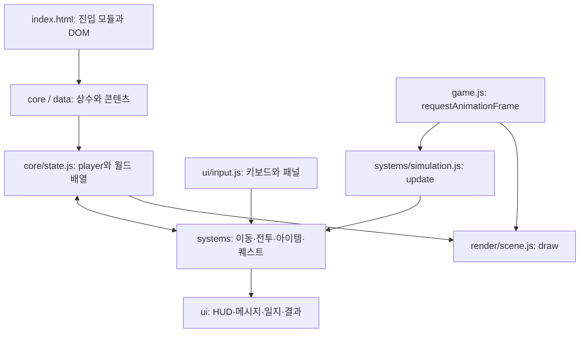

# 두 버전의 개발·배포

`flutter_game/`는 Flutter 3.47.8·Bonfire 4의 새 게임입니다. 루트 `src/`와 `index.html`은 기존 JavaScript 게임으로 유지합니다. 배포 시 루트는 선택 화면, `/sjrpg/legacy/`는 기존 게임, `/sjrpg/new/`는 새 게임입니다. 아래 JavaScript 구조·동작 계약은 기존 버전에 적용합니다.

## Flutter 게임

- `lib/world_model.dart`: 연속 지형 윤곽·수목 몸체·안전 스폰·최대 6px 이동 스윕·제한된 지역 경로 탐색입니다. 주인공·적이 같은 모델을 사용하며 비행·통과 능력을 임의로 부여하지 않습니다.
- `lib/rpg_model.dart`: 직업·24종 장비 템플릿·획득 인스턴스·희귀도·옵션·경험치 레벨·스킬 6종씩·포인트·두 사용 슬롯의 정의입니다. 스테이지 번호는 처치 수나 레벨과 무관하게 1을 유지합니다. 장비는 고유 일련번호로 소유를 확인하고 장착 장비 판매·다른 직업 무기 장착·음수 구매를 거부합니다.
- `lib/battle_effects.dart`: 원소 탄의 5px 이동 스윕·첫 지형/대상 판정, 시야를 검사하는 범위 피해·연쇄 번개·지연 유성·소용돌이 3회 타격, 바닥 전리품·상자·네 방향 출구 표시입니다. 투사체는 종료 상태를 즉시 기록해 제거 대기 중에도 재타격하지 않습니다.
- `lib/game_art.dart`: 공유 생성 이미지·측정 프레임을 읽어 16/8방향 캐릭터·바닥 재질·목교·마을을 표시합니다. 512px 지형 명령 캐시는 최대 24개입니다. 마을 그림의 가장자리 알파 마스크는 로딩 때 한 번만 640×960 텍스처로 만들어 주변 지형에 연결합니다. 프레임마다 합성 레이어를 만들지 않습니다. 그림과 충돌이 같은 월드 데이터에서 나옵니다.
- `lib/adventure.dart`: Bonfire `Player`·`Enemy`·`GameComponent`와 충돌·카메라·키보드 이벤트를 사용합니다. 전체 몸체 지형 스윕은 자연형 맵 모델로 처리하고, Bonfire 충돌이 캐릭터 간 겹침을 해결합니다. 카메라는 판정이 끝난 주인공 좌표를 직접 따라가며 시작의 0초 프레임·회피 중에도 유한 좌표와 화면 중심을 유지합니다. 주변 일반 적 무리는 22마리 이내로 관리하고 보스는 별도 생성하며, 먼 일반 적은 보상 없이 정리합니다. 경로는 현재 몸체가 실제로 도달할 수 있는 시작점을 고르고, 모퉁이 노드에 도착한 뒤 방향을 바꿉니다. 유효한 경로는 목표가 이동하거나 다음 구간이 막힐 때까지 유지해 느린 적도 앞으로 나아갑니다. 연속 베기·회전 공격·회피·피격·성장·보스 결과는 시뮬레이션 시간으로 처리합니다. 각 스킬의 대기시간은 ID별로 유지하며 슬롯을 바꿔도 초기화하지 않습니다. 보스 강타는 고정한 목표 위치를 0.85초 예고하고 지형/거리 검사 후 피해를 주며 기절로 중단할 수 있습니다. 적은 Bonfire 마운트 이후에만 공격 대상으로 삼고, 아직 로딩 중인 적을 원거리 정리하지 않습니다. 렌더링은 피해·스폰·게임 난수를 변경하지 않습니다.
- `lib/main.dart`·`class_selection.dart`·`game_ui.dart`·`game_panels.dart`·`rpg_widgets.dart`: 360도 조이스틱·두 손가락 조작·컨텍스트 상점 버튼·직업 선택·HUD·보스 몸체 체력/예고·물약·장비 DPS 비교/판매·주/보조 스킬 투자/지정·일지/지도·설정·결과 창입니다. 직업 선택은 생성한 청록/황동 팝업 그림을 사용하고, 게임 패널은 얇은 테두리·둥근 모서리의 모바일 시트로 표시합니다. 세로 화면에서는 아래쪽에 정렬하며 제목과 복귀 버튼은 고정합니다. 미니맵은 2,100×2,100의 주변을 따라가며 적·미개봉 상자를 표시하고, 여정 지도는 전체 월드를 표시합니다. 패널·포커스 이탈 시 입력을 해제하고 게임을 멈춥니다. 최초 모바일 높이를 유지하며 게임 영역은 연속 탭 확대를 허용하지 않습니다.
- `lib/device_settings.dart`·`device_bridge*.dart`·`device_controls.dart`: WASM 호환 JS interop으로 전체화면·진동 지원 여부를 확인합니다. 전체화면 상태는 브라우저 이벤트를 따르며 실패 시 UI에 알립니다. 진동 설정은 Legacy와 별도 키로 저장하고, 피드백은 100ms 간격으로 제한합니다(플레이어 피격 우선). 일시정지·백그라운드·세션 종료 시 진동을 취소하고 장치 오류가 전투를 중단하지 않게 합니다. 실제 진동 모터 여부는 브라우저에서 확정할 수 없습니다.
- `scripts/prepare-new-assets.cjs`: 공유 WebP와 `flutter_game/art/`의 마법사 PNG·측정된 프레임 메타데이터를 `flutter_game/assets/`에 준비합니다. 이 생성 폴더와 Flutter 빌드 산출물은 Git에 추가하지 않습니다. 한글 글꼴은 로컬로 포함한 Nanum Gothic(OFL)입니다.

Flutter 변경은 `dart format --output=none --set-exit-if-changed lib test`, `flutter analyze`, `flutter test`, 실제 브라우저의 입력·팝업·전투로 확인합니다. 테스트의 모델·대체 엔진 검사를 실제 웹 렌더링 검증으로 보고하지 않습니다. 현재 새 버전은 전사/마법사·장비·스킬 성장과 제1장 범위입니다. 120마리 처치 후 보스 토벌은 첫 정화 결과를 열며, 계속 탐험하면 적 무리의 추가 보충 없이 남은 전리품과 상자를 찾습니다. 동서남북 출구는 다음 스테이지가 미구현임을 알리고 현재 지역을 유지합니다. 피해 숫자는 최대 14개, 획득/안내 말풍선은 최대 2개로 제한합니다. 진행 저장·후속 스테이지·기존 전체 기능 포팅은 포함하지 않습니다.

## 배포 조립

`npm run build:legacy`는 기존 게임만 `.build-cache/legacy/`에 만듭니다. `npm run prepare:legacy`는 현재 소스와 바이트 단위로 같은 캐시나 공개 Legacy 배포본을 복원합니다. 어느 쪽도 맞지 않을 때만 Legacy를 독립 빌드합니다. `scripts/build.cjs`의 `describeSite()`가 원본 목록·해시·배포 바이트를 공통으로 정의합니다. 복원은 임시 폴더에서 모든 다운로드와 검증이 끝난 뒤 교체합니다. Node 24의 `--use-env-proxy`로 관리형 환경의 네트워크 설정을 따릅니다.

Flutter는 `flutter build web --wasm --release --base-href /sjrpg/new/ --no-web-resources-cdn`으로 독립 빌드합니다. GitHub Pages의 헤더 제약에 맞춰 `forceSingleThreadedSkwasm`을 사용합니다. 지원 브라우저는 `main.dart.wasm`·Skwasm을 로드하고 미지원 브라우저는 Flutter가 함께 만든 JS/CanvasKit 빌드로 실행합니다. `dart:html`을 쓰지 않고 `dart.library.js_interop` 조건부 구현과 `package:web`을 사용합니다. 모바일 진입 높이는 고정하되 실제 `fullscreenchange` 동안만 100dvh를 적용하고 종료 시 원래 높이를 복원합니다.

`npm run build`는 이미 준비된 `flutter_game/build/web/`와 `.build-cache/legacy/`를 복사해 `dist/`를 조립하며 두 게임을 컴파일하지 않습니다. WASM/MJS/JS 산출물이나 Legacy 진입점이 없으면 거부합니다. Flutter 산출물 해시로 `new/releases/<해시>/`를 만들고 `new/index.html`의 base를 설정합니다. 기존 게임은 자체 해시를 유지합니다. 서비스 워커를 등록하지 않습니다. `site/index.html`은 두 개의 짧은 링크만 배치한 스크롤 없는 버전 선택 화면입니다. 새 게임 링크에는 해당 Flutter 산출물의 버전 쿼리를 넣어 이전 진입 HTML 캐시를 피합니다.

GitHub Actions의 **Check and deploy**는 `legacy`·`flutter` 작업을 분리하고 각각 콘텐츠 키로 캐시합니다. Flutter만 바뀌면 Legacy를 다시 빌드하지 않으며, 선택 화면만 바뀌면 두 게임의 빌드 캐시를 재사용합니다. `assemble` 작업은 두 산출물을 받아 Pages 파일로 묶습니다. 완료 보고 전 해당 커밋의 배포 성공과 공개 페이지에서 WASM 리소스·전체화면·진동 API·두 하위 경로 로드를 확인합니다. 진동 API 호출 검증을 실물 기기 진동 검증으로 보고하지 않습니다.
Flutter 월드는 23,040×17,280입니다. 시작 마을과 기존 지형을 보존하고 외곽의 긴 분기 길·순환 길·숲·큰 사구·나무 없는 초원·18개 상자를 배치합니다. 분노는 기본 공격 한 번의 적중당 3, 피격당 7이며 헛스윙은 자원을 주지 않습니다. 전투 이펙트는 `flutter_game/art/combat-fx.png`의 생성형 아틀라스를 재사용하고 전투 판정은 기존 모델이 담당합니다.

---

# 개발 참고

후속 AI 개발을 위한 현재 구조와 동작 계약입니다. 작업 지침은 [AGENTS.md](../AGENTS.md)를 먼저 읽고, 문서의 설명은 실제 코드와 대조합니다.
리뷰 이력이나 완료 기록 대신 현재 구현을 기술합니다.

## 프로젝트 구조

```text
.
├── index.html                 # DOM 패널·진입 모듈·초기 높이 고정 스크립트
├── style.css                  # HUD·패널·시작/결과 화면 스타일
├── playful-pixels.mp3         # 배경음악
├── AGENTS.md                  # AI 개발 지침과 참고 문서 진입점
├── docs/development.md        # 현재 구조·동작 계약·검증·배포
├── src/
│   ├── core/                  # 상수·상태·충돌·Canvas·카메라·모바일 높이 고정
│   │   └── preferences.js     # 소리·진동 설정의 검증·기기 저장
│   ├── data/                  # 콘텐츠 정의와 거리별 적 선택 규칙
│   ├── systems/
│   │   ├── simulation.js      # 프레임별 게임 업데이트 순서
│   │   ├── world.js           # 맵 생성·연결성·타일 조회
│   │   ├── spawning.js        # 적·보스·NPC·초기 배치
│   │   ├── player.js          # 이동·공격 입력·캐릭터 타이머
│   │   ├── combat.js          # 공격·피해·처치·단계 진행
│   │   ├── enemy-ai.js        # 적 상태 머신
│   │   ├── pathfinding.js     # 상태를 참조하지 않는 A* 탐색 엔진
│   │   ├── navigation.js      # 몸체·장애물 판정·경로 캐시·생성 위치 접근성
│   │   ├── entities.js        # 드롭·상자·투사체·장판·효과의 생성/업데이트
│   │   ├── environment-effects.js # 시뮬레이션 시간 기반 분수·안개 파티클 생성
│   │   ├── mounts.js          # 탈것 생성·하차
│   │   ├── consumables.js     # 소비 아이템 사용
│   │   ├── auxiliary-weapons.js # 보조무기 선택·사용
│   │   ├── quests.js          # 수락 가능 여부·진행·보상·클리어 판정
│   │   ├── travel.js          # 포탈·편도 지역 이동
│   │   ├── audio.js           # Web Audio 효과음·MP3 재생
│   │   └── feedback.js        # 타격·피격 진동 및 연속 진동 제한
│   ├── ui/                    # 키보드·터치 조작, 인벤토리·상점·대화·도감·HUD·일지·메시지
│   ├── render/                # Canvas 지형·엔티티·효과·미니맵·시작 화면
│   └── game.js                # DOM 이벤트 초기화·게임 시작·프레임 루프
├── scripts/
│   ├── build.cjs              # 배포용 정적 실행 파일을 dist/에 구성
│   ├── page-sources.cjs       # HTML 진입점과 import/export 그래프 공통 로더
│   └── check.cjs              # 소스 누락·문법·HTML 참조·ESLint 검사
├── tests/
│   ├── game.test.cjs          # 실제 게임 코드를 실행하는 회귀 테스트
│   ├── navigation.test.cjs    # A*·몸체 접근성·보조무기 획득·모듈 격리 검사
│   ├── viewport.test.cjs      # 모바일 진입 높이 고정 검사
│   └── helpers/game-harness.cjs # DOM·Canvas·타이머를 대체하는 VM 환경
├── .github/skills/            # 콘텐츠 추가·디버깅 작업 지침
└── .github/workflows/check.yml # push/PR 검사·main의 GitHub Pages 배포
```

## 아키텍처

게임 코드는 ES Modules의 명시적 `import/export`로 연결됩니다. `index.html`에서는
초기 높이 고정 스크립트와 `type="module"`인 `src/game.js` 진입점만 로드합니다.
각 파일의 변수·함수는 모듈 범위에 있고 다른 파일에서는 필요한 공개 기능을 import합니다.
런타임 의존성은 브라우저 API뿐이며 번들링은 필요하지 않습니다.

변경 가능한 화면·진행 상태와 타일 맵은 `core/state.js`의 `session` 객체에 모았습니다.
플레이어·월드 배열도 해당 상태 모듈에서 export합니다. DOM 초기화는 모듈 로딩 완료 시점의
`document.readyState`를 확인하여 시작 버튼 이벤트를 연결합니다.



`player`, `inventory`, `session`, 월드 엔티티 배열은 import로 전달되는 공유 상태입니다. 시스템은 이 상태를 변경하고,
렌더러는 현재 상태를 Canvas에 그립니다. 패널은 DOM으로 표시합니다.
`update()`는 화면 그리기와 분리돼 테스트에서 독립 실행할 수 있습니다.
`gameLoop()`가 시간 계산, 업데이트, 화면 그리기를 담당하며 종료·일시정지 상태도 그릴 수 있습니다.
화면 크기 변경 시 Canvas 크기·카메라·재그리기 연결도 진입점에서 담당하며 Canvas 모듈은 렌더러를 import하지 않습니다.
렌더링 함수는 월드 엔티티를 생성하지 않습니다. 분수·안개 파티클도 시뮬레이션에서 생성하므로 일시정지·종료 중 증가하지 않습니다.
진행 화면의 NPC·상자·탈것·적·플레이어는 표시용 복사본을 발밑 Y 좌표로 정렬해 그리며 시뮬레이션 배열의 순서를 변경하지 않습니다.
`render/forest.js`는 주변 나무 밀도로 연결된 수관·숲 바닥·가장자리 큰 나무를 표시합니다. 큰 수관은 원본 나무 그림의 잎 부분을 겹쳐 그리며 땅 그리기 뒤 별도 단계로 표시합니다.
밀도는 맵 참조·`terrainRevision`으로 갱신하고, 그림 캐시는 최대 1024개로 제한합니다. 렌더링은 타일·엔티티·게임 난수를 변경하지 않습니다.
숲의 연결성 정리에서는 나무 사이의 접근 불가 빈틈을 덤불로 메웁니다. 실제 물과 사막의 기존 정리는 유지하고 변경 시 `terrainRevision`을 갱신합니다.
`render/presentation.js`는 정적인 지역별 가장자리 음영·저체력 붉은 음영·플레이어 방향 표식을 그립니다.
일반 적의 이름·체력바는 피해를 받았거나 공격·피격 상태일 때만, 보스는 항상 표시합니다.
피해 숫자는 이름 위로 띄우고 테두리·크기 변화로 구분하며 `prefers-reduced-motion`에서는 크기 변화를 생략합니다. 렌더링은 게임 난수를 소비하지 않습니다.
HUD는 DOM 요소와 마지막 표시 값을 보관해 달라진 속성만 갱신하며, 독과 이동 속도 효과를 함께 표시합니다.
시스템이 HUD·메시지 함수를 명시적으로 import하며 일부 순환 의존성은 남아 있습니다.
따라서 이벤트 버스나 모든 시스템의 의존성 주입까지 도입한 구조는 아닙니다.
A* 엔진은 게임 상태에 의존하지 않으며 walkability·edge clearance·goal·heuristic을 함수로 전달받습니다.

업데이트는 플레이어 → 게임 시간 기반 지연 동작 → 적 → 투사체 → 장판·드롭·상자 → 효과·카메라 →
회복·시간 제한·상태 이상 → 퀘스트·포탈 순으로 진행합니다.
적의 공격·투사체·함정 상자로 치명적인 피해를 받으면 종료 판정을 우선해 같은 프레임의 후속 회복으로 되살아나지 않게 합니다.

게임 행동은 `canAct()`로 시작·종료·일시정지·인벤토리·생존 상태를 검사합니다.
월드 초기화는 `clearWorldEntities()`와 `WORLD_ENTITY_LISTS`를 사용합니다.
부메랑 같은 게임 지연 행동은 `deferGameAction()`으로 예약하여 일시정지 때 멈추고 지역 이동 때 취소합니다.
공격·헛스윙·피격의 반복 메시지는 출력하지 않습니다. `ui/messages.js`는 획득·회복·중요 안내를
캐릭터의 화면 위치에 맞춘 말풍선으로 최대 2개 표시하고 2.2초 뒤 제거합니다. 화면 밖으로 나가지 않게 제한하며
Canvas 배율·카메라 이동·Visual Viewport를 반영하며 모달보다 아래에 표시합니다. 말풍선 제거·슬롯 연출은 브라우저 타이머를 사용합니다. 배경음악은 HTML audio 요소로 재생합니다.

적·상자·NPC·탈것 생성은 전체 몸체가 들어갈 수 있는 위치를 검사합니다.
지상 적은 중앙 도착 지점에서 해당 몸체 크기로 도달 가능한 위치에만 생성합니다.
명시적으로 비행·위상 이동 능력이 있는 적만 지상 경로 조건에서 제외합니다.
사막 도착 지점은 열린 지형이며 파라오는 전체 몸체로 접근 가능한 공간을 찾습니다. 파라오는 일반 적보다 먼저 생성하며
후보 검색에서 전체 몸체·거리·접근성·점유를 함께 확인합니다. 생성 실패 시 등장 메시지를 표시하지 않습니다.

### 길찾기와 접근성

- 지상 적의 추적·배회·원거리 접근은 직선 경로가 막히면 A*의 4방향 격자 경로로 우회합니다.
- 노드에서는 몸체 전체의 지형·닫힌 상자 충돌을 확인하고, 연결 구간도 8px 이하 간격으로 검사합니다.
- 추적 목표는 플레이어가 있는 타일을 무조건 차지하는 것이 아니라 몸체 간 공격 거리까지 접근하는 것입니다.
- 유효 경로는 최대 0.7초 재사용하며 목표 타일·맵 변경·다음 구간 막힘을 감지하면 다시 탐색합니다.
- 생성 위치 접근성은 몸체 크기·맵·지형 변경·상자 배치를 기준으로 캐시합니다.
- 지나갈 수 없는 좁은 통로는 몸체를 억지로 통과시키지 않습니다. 길이 없으면 정지하고 재탐색합니다.
- 움직이는 적과 플레이어는 실제 이동 충돌로 처리합니다. 여러 적의 통행 우선순위·군집 분산까지 구현하지는 않았습니다.
- 넉백은 8px 이하 단계로 충돌을 검사합니다. 원거리 적의 횡이동은 0.5초마다 고른 방향과 시뮬레이션 시간 기반 속도를 사용합니다.

### 보조무기 구매

마을 상점에서 대회복약(120골드), 얼음 폭탄(150골드), 도발 북(120골드)을 판매합니다.
암시장과 사막 상점에서는 위 세 종류와 벼락(200골드), 독 안개(180골드)를 판매합니다.
구매 시 정의를 복사해 남은 횟수를 개별 관리하며 보조무기 목록에 추가하고 도감에 기록합니다.
처음 획득한 보조무기는 자동 선택됩니다. 소비 아이템 3칸·주무기 인벤토리 12칸과 별도로 보관합니다.

적 투사체와 플레이어 투사체는 이동 구간에서 가장 먼저 만나는 벽 또는 대상을 판정해
빠른 투사체가 작은 적을 지나치거나 벽 너머를 공격하지 않게 합니다.
원거리 주무기의 투사체 수명은 `range / projectileSpeed`로 계산합니다. 전설검의 근접 범위와 투사체 범위는 별도입니다.

### 아이템·피해·결과

- 인벤토리의 Delete·버리기 버튼은 선택 무기를 바닥에 복사해 놓고 슬롯을 비웁니다. 바닥 수명은 120초,
  재습득 유예는 게임 시간 1초이며 장착 중 무기와 정의 템플릿은 변경하지 않습니다.
- `damageEnemy()`의 `stagger: false` 옵션은 지속 피해가 기존 피격 경직을 갱신하지 않게 합니다.
  장판·독의 주기 피해는 넉백도 부여하지 않습니다. 직접 타격·빙결의 기존 우선순위는 유지합니다.
- 덫은 `singleUse` 장판으로 적 하나에 피해·속박을 적용한 뒤 사라집니다. 폭탄은 단발 피해이며,
  화염병의 즉시 피해와 지속 피해는 각각 데이터에 정의합니다.
- 독의 단검의 독은 적별로 지속 시간과 틱을 보관하며 재적용 시 틱 진행을 유지합니다.
  독 처치는 일반 처치 경로를 사용하고 적 배열의 스냅샷을 순회해 처치·단계 스폰 중에도 갱신 순서를 유지합니다.
- 최종 승리는 남은 시간 비율 50% 이상 S, 30% 이상 A, 10% 이상 B, 그 외 C입니다.
  실패 등급은 기존 처치·보유 골드·피해량 점수로 계산합니다. 결과의 골드는 누적 수입이 아닌 보유액입니다.

## 드롭·참고 수치·그림

`systems/boat-waters.js`는 연결된 물 48타일 이상, 배 몸체가 들어가는 2×2 물 영역의 연결 위치 24개 이상과 가로·세로 5칸 이상의 항해 범위를 검사합니다. 초기 배는 이 수역 안에서 기존 전체 몸체·물가 탑승 검사를 통과한 위치에만 생성합니다. 작은 웅덩이·가느다란 물길·분리된 수역의 합산은 허용하지 않습니다.

`systems/loot.js`는 획득 시 중복 무제한 무기를 가치의 20% 골드로 전환하며 알림은 골드 금액만 표시합니다. 새 무기·횟수 제한 무기는 기존 보관·바닥 드롭 경로를 유지합니다.
직접 버린 무기는 `autoSalvage: false`로 재습득을 보존합니다. 콘텐츠의 `reference`는 SRD 원전 정보이고 실제 HP·ATK는 별도 조정치입니다.
[콘텐츠·아트 출처](content-reference.md)에 원전·번역·실시간 변형·생성 이미지 사용을 기록합니다.
`ui/art.js`는 4×4 생성 아이콘을 DOM에, `render/art.js`는 같은 시트를 Canvas에 표시하며 로딩 전에는 기존 몬스터 그림을 사용합니다.
바닥의 2×2 `terrain.webp`는 로드 후 512×512 Canvas에 한 번 축소·대칭 배치해 잔디·흙·모래·돌길 타일에 사용하며 로딩 전에는 절차형 지형을 그립니다.
재질 한 칸이 월드의 8×8 타일에 경계 없이 이어지도록 월드 좌표로 잘라 그리므로 카메라 이동으로 질감이 바뀌지 않습니다.
`data/art.js`는 숲·사막 4×4 월드 시트의 프레임을 정의하고 `render/world-art.js`는 기존 몸체의 발밑에 그림을 맞춥니다.
월드 시트는 네 방향 모험가·주민·시설·주요 적·탈것에 사용하며 이미지 로딩 실패·지연 시 기존 그림으로 실행합니다.
`ancient-dragon.webp`는 고대 드래곤 전용 투명 이미지이며 원본 종횡비와 발밑 위치를 유지합니다. 체력바·이름도 실제 그림 상단에 맞춥니다.
숲 광장의 SAND는 돌길 재질로 표시하고 사막은 모래 재질을 유지합니다. 타일 충돌 속성은 바꾸지 않습니다.
[월드 아트 기준](art-direction.md)에 대표 이미지·시트 배치·지역별 적용을 기록합니다.
`ui/art.js`는 헤더 시트·조작 시트·팝업 프레임을 각각 로드해 준비된 영역에 클래스를 붙입니다. 로딩 전·실패 시 CSS·SVG 조작을 유지합니다.
`data/ui-art.js`의 실제 그림 영역과 `ui/sprite-layout.js`의 배경 위치 계산으로 조이스틱 바닥·손잡이·공격·메뉴를 정렬합니다. 셀 여백을 그림 중심으로 취급하지 않습니다.
공격 버튼은 검 문양 하나만 표시하며 장비 배지를 추가로 그리지 않습니다. 팝업은 생성한 프레임의 9분할 테두리를 공유합니다.
빈 소비 아이템 바와 대상 없는 대화 버튼은 모바일에서 숨기며, 데스크톱에서도 하단 그림 메뉴를 사용할 수 있습니다.
`world-mounts.webp`의 탈것 4종×4방향은 `data/art.js`의 실제 그림 경계를 사용해 잘라 그리고 종횡비·발밑을 유지합니다.
이동 입력은 `player.dir`과 탑승 중 `mount.dir`을 맞추고, 내릴 때 저장한 방향을 재탑승 시 복원합니다. 렌더링은 방향을 변경하지 않습니다.
빌드는 `assets/`의 WebP 파일을 모듈·CSS와 같은 버전 디렉터리에 포함합니다.

## 모바일 높이 고정

터치 중심 기기(`pointer: coarse`)에서는 페이지 진입 시 `window.innerHeight`를 한 번 읽어
`--app-height`에 픽셀 값으로 저장합니다. 최상위 레이아웃과 게임 영역의 높이가
이 값을 사용하므로 주소창이 숨겨지거나 나타나도 높이를 다시 계산하지 않습니다.
터치 기기는 게임 영역을 확대하지 않고 고정 높이 전체를 사용합니다. 데스크톱의 기존 1.5배 확대는 유지합니다.
가로 폭은 계속 화면에 맞추며 데스크톱에서는 기존 창 크기 변경 동작을 유지합니다.
고정은 현재 페이지가 열린 동안 유지됩니다. 화면 회전 후에도 최초 높이를 유지하므로
새 방향의 높이에 맞추려면 페이지를 새로고침해야 합니다.
사용자가 전체화면을 선택한 동안에는 전체화면 높이를 사용하며, 해제하면 원래 고정 높이로 돌아갑니다.
팝업은 게임 화면의 고정 높이·확대 배율과 분리된 최상위 `#popupLayer`에 둡니다.
`ui/popup-layout.js`가 Visual Viewport의 크기·오프셋을 추적하고, 미지원 시 창 크기를 사용합니다.
주소창·회전·전체화면 전환은 팝업 영역만 갱신하며 `--app-height`를 변경하지 않습니다.
높이 변경·회전·재진입의 고정 규칙은 회귀 테스트로 확인했으며 실제 모바일 주소창 동작은 기기 검증이 필요합니다.

`render/weapon-effects.js`는 주무기 16종의 서로 다른 궤적·문양과 원거리 무기별 투사체를 그립니다. 공격 시작 때 복사한 `player.attackVisual`과 `lastAttackCooldown`을 사용하므로 무기가 마지막 사용에서 부서져도 해당 공격의 그림은 유지합니다. 그림은 공격 타이머만 읽고 난수·전투 상태를 변경하지 않습니다. 투사체의 `weaponId`는 표시용이며 판정·수명·피해를 변경하지 않습니다.

### 터치 입력과 모바일 표시

- 거친 포인터가 있는 기기의 게임 영역과 조작부 전체에 `touch-action: none`을 적용합니다. 비활성 버튼·버튼 사이 빈 공간에도 적용하며 조작부의 `dblclick` 기본 확대도 막습니다. 별도 팝업 영역은 세로 스크롤을 유지합니다.

- `ui/touch-controls.js`는 Pointer Events와 포인터 캡처를 사용합니다. 조이스틱·공격 포인터를 별도로 추적해
  이동과 연속 공격을 동시에 처리하고, 다른 손가락을 떼어도 남아 있는 입력을 유지합니다.
- 키보드 `keys`와 `touchKeys`는 분리하고 플레이어는 `isKeyDown()`으로 합쳐 읽습니다. 터치 해제가 키보드 입력을 지우지 않습니다.
  단발 동작은 키보드와 같은 `performInputAction()` 경로를 사용하므로 일시정지·종료·슬롯머신 제한도 같습니다.
- 패널 열기·일시정지·종료·포인터 취소·캡처 해제·포커스 이탈·문서 숨김 시 터치 입력을 해제합니다.
  퀘스트 일지를 직접 열면 `session.questJournalOpen`과 일시정지를 함께 관리하고 닫을 때 해제합니다.
- `pointer: coarse`에서 조작 버튼·HUD·반응형 패널을 표시합니다. HUD·조작 안내는 12~14px,
  팝업 본문은 14~16px를 사용합니다. 인벤토리는 세로 2열·가로 3열이며 설명은 줄임 없이 표시합니다.
  폭 600px 이상·높이 500px 이하의 가로 화면에서 조작 영역의 높이를 줄이고,
  목록은 세로 스크롤을 허용하며 게임 조작 영역만 브라우저 터치 제스처를 막습니다. 패널마다 닫기 버튼을 제공합니다.
- 공격 버튼에는 검 문양과 실제 `attackTimer / lastAttackCooldown`의 원형 게이지를 표시하며 대기 중에도 누르고 있기 입력을 유지합니다.
  보조 버튼에는 남은 횟수·초 단위 대기시간·원형 재사용 게이지를 표시합니다.
  주요 퀘스트 완료 수와 활성 퀘스트는 모험 일지에 모으며, 모바일의 일지는 하단 메뉴에서 엽니다.
  모바일 상단의 장비 요약은 표시하지 않고 장착 정보는 조작 버튼·가방에서 확인합니다. 미니맵 아래에는 현재 지역을 표시합니다.
- `systems/interactions.js`의 대상 선택을 터치 안내·NPC·포탈 상호작용이 공유합니다. 몸체 사이 거리 40px 미만,
  기본 안내는 포탈·NPC·탈것 순으로 선택하고 동일 종류는 가까운 대상을 사용합니다. 직접 터치하면 누른 대상 중에서 선택합니다. 대상이 없으면 터치 버튼을 비활성화합니다.
  탈것은 이동·겹침으로 자동 탑승하지 않습니다. `boardMount()`가 명시적 입력 때 거리·전체 몸체 배치·게임 상태를 검사한 뒤 탑승합니다.
  표시 문구는 ‘상점·대화·이동·타기’처럼 짧게 하고 대상 이름은 접근성 이름에만 포함합니다.
  머리 위 동작은 11px 반투명 태그 하나로 표시하고 Canvas의 중복 안내를 그리지 않습니다. 태그의 실제 누름 영역은 64×44px이며 우하단 버튼·접근성 이름을 유지합니다.
  터치 기기는 Canvas의 짧은 탭(이동 14px 이하)으로 현재 대상의 몸체를 눌러 열 수 있고, 대상 위에도 열기 버튼을 표시합니다.
  이동 드래그·취소·일시정지 중 탭은 실행하지 않습니다.
- 폭 599px 이하의 터치 화면에서는 팝업을 하단에 정렬하고 헤더·복귀 버튼을 고정합니다.
  아이템은 조이스틱 위에, 내리기는 공격 버튼 위에 두어 좁은 화면의 겹침을 줄입니다.
  가방 본문에는 현재 장착 무기·공격력과 사용 중인 보관 칸 수를 표시합니다.
- 대표 이미지의 UI 시트를 초상·원형 프레임·조이스틱·하단 메뉴에 사용합니다. 체력·단계·골드·시간을 상단에, 메뉴를 하단에 모으며 세로 화면의 카메라 기준점을 화면 높이 43%에 둬 조작 영역을 비웁니다.
  공통 `game-window`·`window-header`·`window-body`·`window-footer`와 HTML 내부 SVG 심벌로 프레임·아이콘·닫기 버튼을 통일합니다.
  본문만 스크롤하고 헤더·푸터는 유지합니다. 복귀·재도전 버튼은 푸터, 상점 잔액은 헤더에 두고 화면 안전 영역을 확보합니다.
  상태 효과 영역은 독·스피드 효과가 있을 때만 공간을 차지합니다. 인벤토리의 키보드 열 수는 실제 Grid 열 수를 사용합니다.
- 도감 항목은 기본 버튼이며 상세정보는 고정 푸터에서 표시하고 긴 내용만 별도로 스크롤합니다.
  게임 키 처리기는 버튼의 Space·Enter 기본 동작을 가로채지 않습니다.
- `tests/game.test.cjs`의 터치 회귀는 DOM 이벤트 대체 환경이며, 실제 멀티터치·패널 스크롤·작은 화면 배치는 브라우저에서 별도로 확인합니다.

### 설정과 피드백

- `ui/settings.js`의 설정 패널은 `session.settingsOpen`·일시정지를 함께 관리합니다. 기존 패널이나 슬롯머신을 덮어 열지 않습니다.
- `core/preferences.js`는 진동·음악·효과음의 불리언 값만 저장하며, 저장소 접근이 막혀도 현재 세션에서 설정을 사용합니다.
  이 저장은 모험 진행 저장과 별개입니다.
- 진동은 직접 적중·근접 피격·적 투사체·함정 피격에서 발생하며 장판·독 피해는 진동을 만들지 않습니다.
  적중 진동은 70ms 간격으로 제한하고 끄기·화면 숨김·포커스 이탈 때 즉시 취소합니다.
- 효과음을 끄면 오디오 노드를 생성하지 않습니다. 음악 재생 재시도도 현재 음악 설정을 확인합니다.
- 전체화면은 설정 패널의 버튼에서 브라우저 API를 호출하고, 미지원·거절 시 설정에 안내합니다. 전환 중에는 해당 버튼을 비활성화해 요청 중복을 막고,
  성공·거절 후 다시 활성화합니다. 전환 이벤트에서 Canvas와 카메라를 갱신합니다.

## 검증

Node.js 24 이상이 필요합니다. 런타임 실행에는 npm 설치가 필요하지 않습니다.

```sh
npm ci
npm run check
npm run build
```

| 명령                   | 용도                                                                          |
| ---------------------- | ----------------------------------------------------------------------------- |
| `npm run lint`         | HTML 소스 목록·ID 중복·누락, 문법, 정적 HTML ID 참조, 미정의/미사용 변수 검사 |
| `npm run format`       | Prettier 포맷 적용                                                            |
| `npm run format:check` | 포맷 확인                                                                     |
| `npm test`             | Node 내장 테스트 러너로 게임 회귀 검사                                        |
| `npm run check`        | lint → 포맷 확인 → 전체 테스트                                                |
| `npm run build`        | 모듈 그래프 검증 후 실행 파일만 dist/에 구성                                  |

정적 검사와 테스트는 `scripts/page-sources.cjs`의 동일한 import 그래프를 사용합니다.
소스별로 ESLint를 실행하고 import 경로·named export·HTML ID·미정의 변수·import 대입을 검사합니다.
새 모듈은 사용하는 파일에서 import해야 하며, 진입점에서 도달하지 않는 소스는 검사에서 실패합니다.
회귀 테스트는 Node의 `vm.SourceTextModule`로 실제 모듈을 링크·실행합니다.
테스트 명령에 필요한 `--experimental-vm-modules` 옵션은 npm 스크립트에 포함돼 있습니다.
테스트 시나리오 접근자는 하네스에만 있으며 브라우저의 전역 공간에 게임 변수를 노출하지 않습니다.
동적 HTML ID와 모든 런타임 초기화 문제까지 정적 검사가 보장하지는 않습니다.

VM 하네스는 HTML에 없는 ID 조회에 `null`을 반환하며, 타이틀 초기화부터 시작 버튼 클릭·첫 프레임까지 검사합니다.
빌드 회귀는 이전 UI 코드와 새 HTML의 혼합 오류, 버전 경로의 변경과 전체 모듈의 경로 일관성을 검사합니다.
자동 테스트는 DOM·Canvas·오디오를 대체하므로 실제 화면·사운드 품질을 보장하지 않습니다.
기능 변경 시 관련 브라우저 동작을 확인하고, 확인하지 못한 범위는 완료 보고에 명시합니다.

## 배포

`main`에 푸시하면 GitHub Actions가 의존성을 설치하고 `npm run check`를 실행합니다.
검사를 통과한 커밋의 `dist/` 빌드 산출물을 Pages 아티팩트로 업로드하고 배포합니다. PR에서는 검사·빌드만 실행합니다.
Actions의 **Check and deploy** 워크플로를 수동 실행해 다시 배포할 수도 있습니다.

배포는 루트 `index.html`과 `assets/<콘텐츠 해시>/` 안의 `style.css`, `playful-pixels.mp3`, `src/`로 구성합니다.
HTML·스타일·모듈 중 하나라도 바뀌면 모든 실행 리소스가 새 경로를 사용하므로 이전 브라우저 캐시와 섞이지 않습니다.
모듈 내부 상대 경로는 유지하며 소스 체크아웃은 기존 경로로 바로 실행할 수 있습니다.
개발 도구·테스트·`node_modules`는 배포 파일에 포함하지 않습니다.
모든 리소스는 상대 경로를 사용하므로 `/sjrpg/` 경로에서도 실행됩니다.
저장소 Settings → Pages의 Source는 **GitHub Actions**입니다.

### 고정 마을과 연속 지형

`data/village.js`의 월드 사각형(분수 X−320, 분수 Y−256,640,960)과 지형 마스크를 맵 생성·그림·전투가 공유합니다. 분수·집·상점·수관을 막고 고정 중앙 전투길과 서쪽·북쪽 출구를 보존합니다. 실제 숲 도착 지점은 분수 아래 175px이며 접근성 탐색도 이 길에서 시작합니다. 그림과 충돌을 맞추기 위해 보스 지형 파괴는 생성 지형에서 실행하지 않습니다.
`render/village.js`는 UI·인물 없는 `village-scene.webp`를 월드 좌표에 그립니다. 상점의 중복 건물은 표시하지 않으며 실제 NPC·터치 상호작용은 유지합니다. 시작 장비는 롱소드·수리검의 복사본입니다.

`data/landscape.js`는 월드 전체의 유기적인 생태 구역·호수·강·곡선 길·다리·수목 몸체를 만듭니다. 독립된 방의 사방 출입구나 고정 크기 장면을 반복하지 않습니다. 월드는 지역마다 240×180칸(7,680×5,760px), 분수 중심은 (3,840,2,880)이며 표시 크기는 유지합니다. 지형 윤곽과 수목은 시드에 따라 달라집니다. 넓은 빈터·모래는 보행 가능하고, 실제 수역과 나무·바위의 몸체만 막습니다. 수목은 길에서 충분히 떨어뜨리며 길 중심은 플레이어 전체 몸체로 통과할 수 있어야 합니다. 생성 지형에는 `ensureConnectivity()`의 고립 지형 변경을 적용하지 않아 보이는 길을 보이지 않는 물로 바꾸지 않습니다.
`session.landscapeMap`은 생성된 맵 참조이며 맵 교체나 지역 변경 시 이전 배경을 그리지 않습니다. `render/landscape.js`는 같은 윤곽과 길을 생성 바닥 재질로 그립니다. 세계 좌표에 고정한 재질을 겹쳐 접합하고 반사 대칭 무늬를 만들지 않습니다. 내부 512px 렌더 캐시는 지형 구역을 나누지 않으며 최대 24장으로 제한합니다. 지원 브라우저에서는 유휴 시간에 이동 방향 앞쪽 캐시를 한 장씩 미리 준비합니다. 길은 모든 가장자리를 먼저, 모든 내부를 나중에 그려 교차부에 테두리가 남지 않습니다. 실제 다리는 별도 생성 그림의 측정 경계를 사용합니다. 수목은 공간 버킷으로 화면 주변만 선택하고 캐릭터와 발밑 순서로 그리며 주인공을 가리는 나무는 반투명해집니다. 렌더링은 게임 난수·지형·전투 상태를 변경하지 않습니다.
미니맵 지형은 맵 참조·지형 변경 번호·표시 크기가 바뀔 때만 재생성하고 캐릭터·표식은 계속 갱신합니다.

### 주변 전투와 연산 범위

`trail-encounters.js`는 시뮬레이션 10초마다 플레이어 주변 260~390px에서 지역·시작점 거리별 적 무리를 보충합니다. 이동 방향 앞쪽부터 생성 위치를 찾고 순찰 무리는 520px 안에서 추적해 전투에 합류합니다. 탐험 위치가 560px 이상 바뀌면 보충 타이머를 갱신합니다. 주변 620px에 살아 있는 적 9마리, 일반 적 전체 40마리에서 추가를 중단합니다. 1,600px 넘게 떨어진 일반 적은 보상 없이 제거하고, 한도가 찬 경우 700px 밖의 일반 적을 일부 정리해 현재 지역의 전투를 유지합니다. 보스·독 피해 처리 중인 적은 이 정리에서 제외합니다. 일시정지·사망·마을 안전 구역에서는 보충하지 않습니다. 스폰은 전체 몸체·도착 지점 접근성·엔티티 충돌을 검사합니다.
1,200px 밖의 적은 상태·독 타이머를 처리하되 배회·길찾기·충돌 연산을 중지합니다. 가까워지면 다시 동작합니다. 막힌 배회 목표에는 경로를 요청하지 않으며 A*는 요청별 방문 수를 제한합니다(배회 512, 추적 4,096). 실패 경로의 재요청은 1.8초 후이며 유효 경로는 0.7초마다 재검토합니다. 실제 공격·넉백·빙결·일시정지·보상 계약을 유지합니다.

### 지상 충돌

`core/collision.js`의 `ignoresTerrain()`는 명시적 `flying` 또는 `phasing`만 허용합니다. `megaBoss`는 크기·보상·공격 거리 분류입니다. 드래곤은 비행, 마왕은 위상 이동이며 다른 지상 보스도 전체 몸체로 장애물을 검사합니다.
`moveWithCollisions()`는 이동·넉백을 최대 8px 단계로 나누고 두 축의 몸체·엔티티 충돌을 검사합니다. 플레이어·탈것도 같은 단계 이동을 사용하며 정확히 맞닿은 경계는 겹침이 아닙니다. 도보 기본 속도는 245px/s입니다. 수상 탈것에서 내릴 육지가 없으면 실제 도착 길의 유효 위치로 이동하며, 유효한 곳이 없으면 탑승을 유지합니다.

### 자유 각도 이동·방향별 애니메이션

`ui/input.js`의 `touchStick`은 연속 벡터·활성 상태를 보관합니다. 조이스틱은 20% 데드존 이후 기울기로 속도를 바꾸며 키보드 대각선도 정규화합니다. 해제·패널·포커스 이탈 때 입력을 초기화합니다. 그림만 16/8방향으로 선택하고 이동·조준은 연속 각도로 실행합니다.
`core/facing.js`는 `facingAngle`과 호환용 네 방향 `dir`을 연결합니다. 실제 이동 벡터로 방향을 갱신하며 멈추면 마지막 방향을 유지합니다. 주민은 플레이어 쪽을 보고 탈것의 방향은 재탑승해도 유지됩니다.
`data/actor-art.js`·`actor-bounds.js`는 실제 시트 경계를 사용합니다. 주인공은 16방향×걷기 2자세·검 공격 2자세, 나머지는 기본 8방향×2자세이며 필요한 시트만 로드합니다. 공격 시작 때 저장한 `attackAngle`을 자세·효과에 사용합니다. 멈춘 상태의 터치 연속 공격은 140px 이내 적을 조준합니다. 투사체·보조무기도 연속 각도를 사용하며 부메랑 귀환은 던진 각도의 반대입니다.
