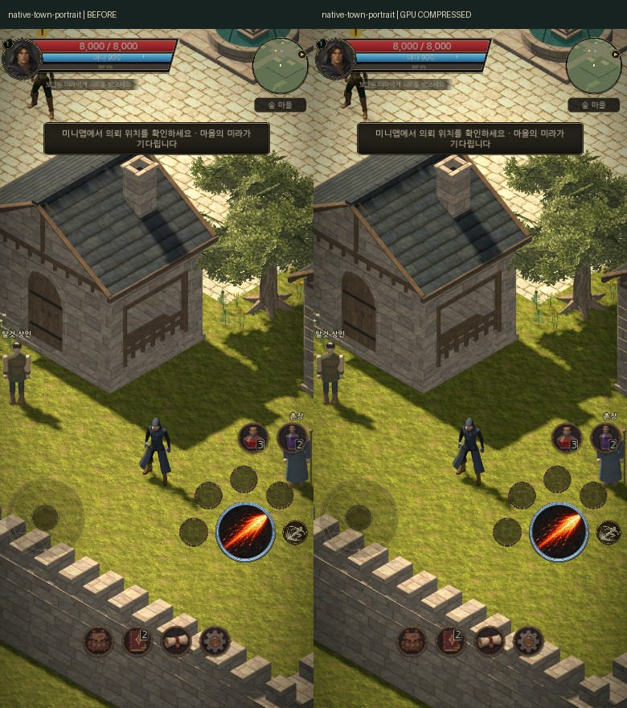
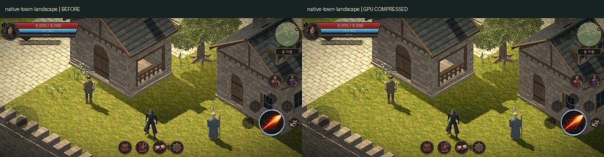
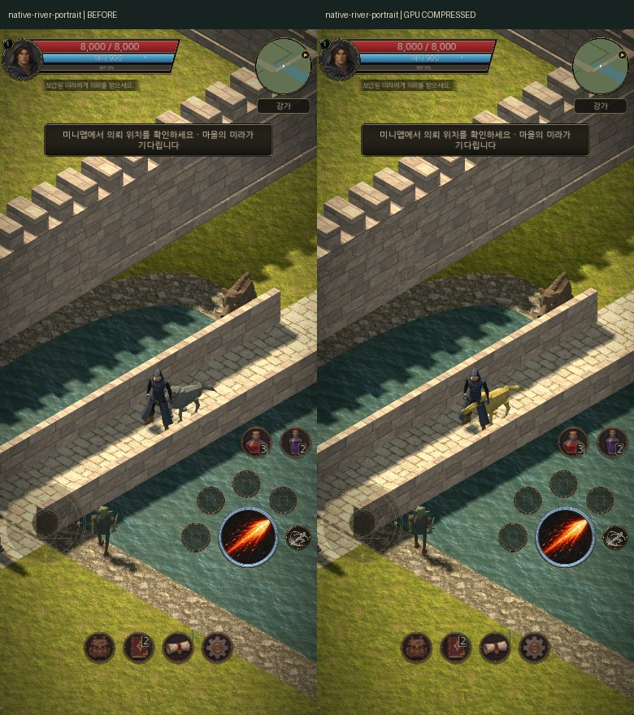
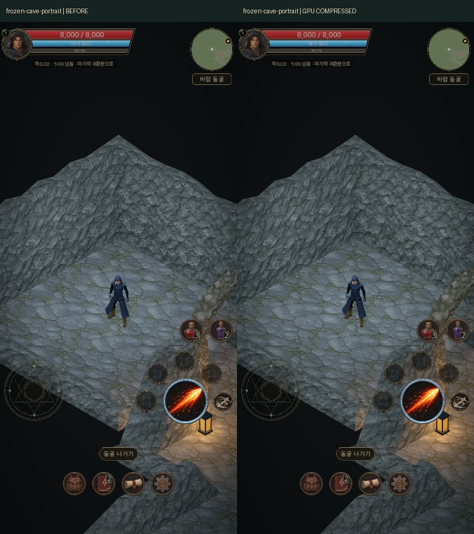
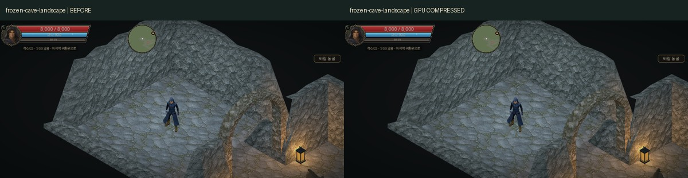
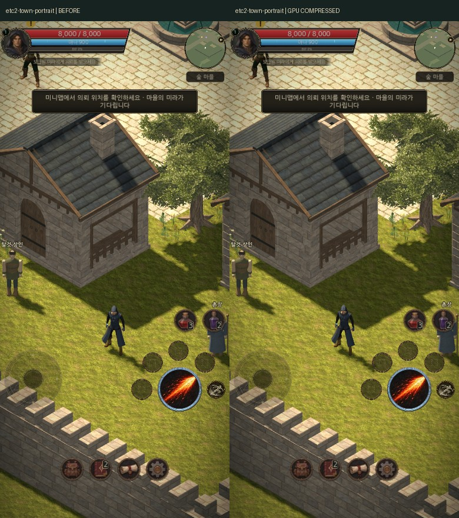
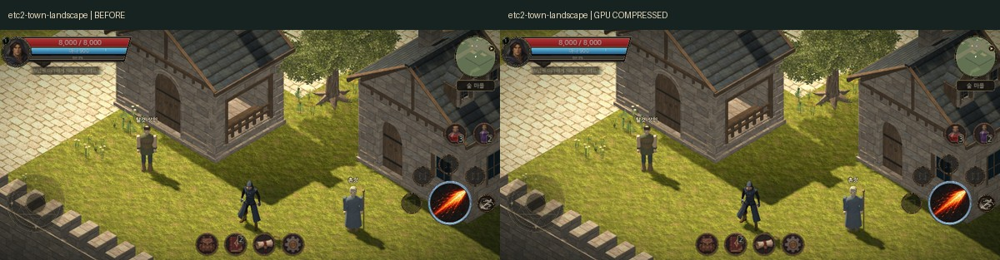
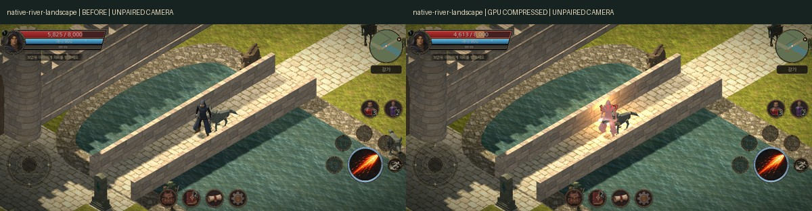

# Web·Android GPU 압축 비교

2026-11-08 실제 Godot 4.7.2 WebGL2 실행 화면입니다. 왼쪽은 기존 임포트, 오른쪽은 GPU 압축 적용본입니다. 생성형 이미지가 아닙니다. 원본 이미지·UV·논리 해상도는 유지했습니다.

- 기준: `fa2ab4215446fd05cb6fbbe923f78b1eacd71a74`
- GPU 적용 촬영: `ff5463085161ad533dde83b0f27d53257553a871`
- [촬영·리소스 검사](https://github.com/obmaz/sjrpg/actions/runs/42472571299), [엄격한 카메라 대응 비교](https://github.com/obmaz/sjrpg/actions/runs/42473409281), [최종 코드 재검사 통과](https://github.com/obmaz/sjrpg/actions/runs/42474336474)
- [실측 JSON](comparison.json), [Android 빌드 증거](android-build.json), [설정과 재현 방법](../../../sjrpg_3d/docs/platform-exports.md)

동일 카메라·투영·해상도 검사를 통과한 7쌍을 독립 리뷰어가 직접 검수했습니다. 큰 색 변화·돌/나무 디테일 손실·알파 경계 오염은 발견하지 못했습니다. GPU 블록 압축은 손실 방식이며 미세한 차이는 생길 수 있습니다.

## PC 웹 · 실제 S3TC

### 마을 세로

### 마을 가로

### 강 세로

마을과 강은 실행 중인 게임입니다. 캐릭터·효과의 시간에 따른 변화는 텍스처 압축 차이와 구분합니다.

### 동굴 세로

### 동굴 가로

동굴은 기존 일시정지 촬영 fixture입니다. 동작·전투 성능 검증으로 해석하지 않습니다.

## 모바일 웹 형식 · 실제 ETC2

ETC2 지원을 확인한 WebGL2 컨텍스트에서 S3TC/BPTC/ASTC 노출만 막아 엔진이 ETC2를 선택하도록 했습니다. CTEX 경로·헤더·압축 GPU 업로드 형식을 확인했습니다. 실제 Android 휴대폰 실행을 대신하는 결과는 아닙니다.

## 메모리와 패키지

| 측정 | 기존 | GPU 압축 |
| --- | ---: | ---: |
| 마을 일반 화면 · 엔진 텍스처 메모리 | 185,324,592 B | 175,284,716 B |
| 동굴 fixture · 엔진 텍스처 메모리 | 187,771,202 B | 175,983,728 B |
| 10개 표면 전체를 명시적으로 읽은 마을 통제 측정 | 187,421,742 B | 175,634,268 B |

선택한 10개 텍스처의 실제 GPU 블록 데이터는 S3TC·ETC2 각각 2,363,568바이트입니다. 같은 해상도·밉맵의 RGBA8 산술 예산 18,868,056바이트는 이전 실제 GPU 점유량이 아닙니다. 위 표는 엔진 집계이며 기기 전체 RAM/VRAM·FPS나 탭 종료 해결을 입증하지 않습니다.

두 형식을 함께 담은 Web PCK는 35,695,708바이트입니다. 다운로드 크기 절감과 GPU 텍스처 메모리 절감은 별개의 효과입니다. Android APK는 ETC2만 포함하며 실제 서명·패키지 검사를 통과했습니다.

## 대응 비교에서 제외한 보조 사진

아래 강 가로 사진은 전투 중 카메라 반응으로 최대 0.039974m 차이가 나서 엄격한 카메라 대응 기준을 통과하지 못했습니다. 위 7쌍의 화질 검수 수에 포함하지 않습니다.

