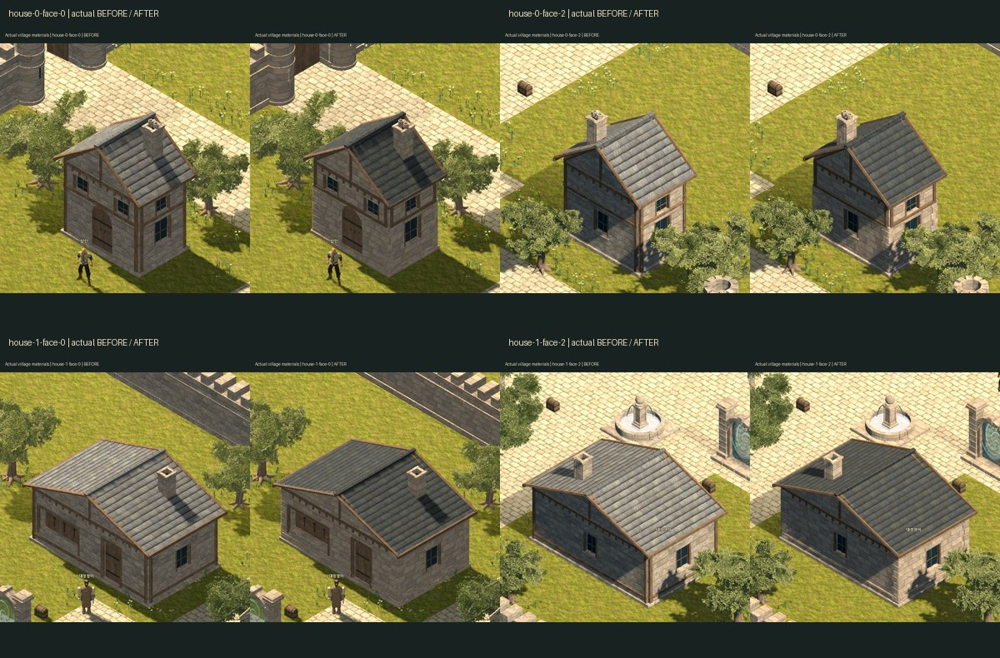
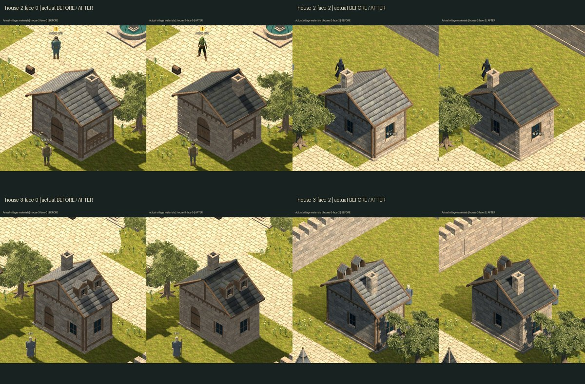
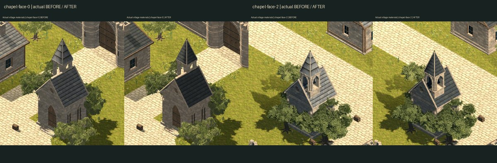
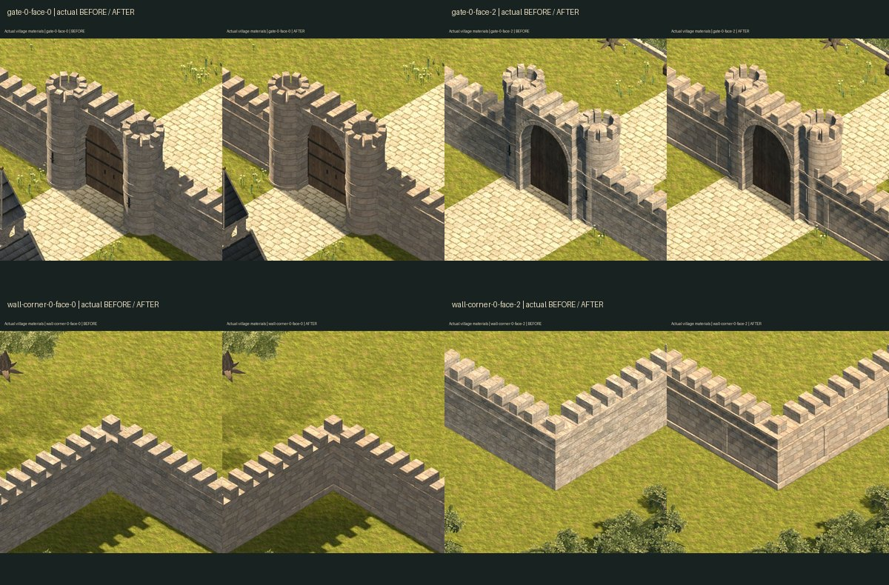
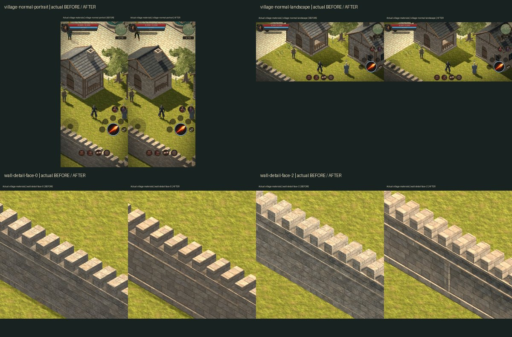
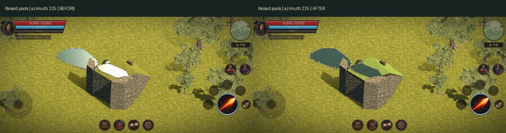

# 마을 에셋 디자인 보기

게임에서 사용하는 실제 3D 모델과 변경 전후 화면입니다. 원본 디자인은 [Quaternius 판타지 의상 팩](https://quaternius.itch.io/modular-character-outfits-fantasy)에서 볼 수 있습니다.

## 성벽·집·상점·예배당

성문·성벽·예배당·주택은 같은 석회암과 청회색 슬레이트 패밀리를 사용합니다. 실제 벽기둥·덮개·모서리 석재·기와 겹침과 보 방향의 목재 UV를 적용했습니다. 아래는 실제 게임에서 촬영한 변경 전후입니다. 각 짝의 왼쪽이 이전, 오른쪽이 수정본입니다.

[집 확대](house-3-face-0-comparison.jpg) · [성벽 확대](wall-detail-face-0-comparison.jpg) · [예배당 확대](chapel-face-0-comparison.jpg)

같은 직교 카메라·조명에서18개 화면을 촬영하고 원래 지형·정적 충돌 기하가 같은지 검사했습니다. [실제 비교 자료](architecture-review.json)와 [브라우저 검수](https://github.com/obmaz/sjrpg/actions/runs/42465788468)에 소스와 이미지 해시를 보존합니다. 검수 범위는 공통 재질·실제 건축면·화면 구도·기존 충돌과 동선입니다.

## 공개 에셋 NPC

| 대상 | 현재 디자인과 출처 |
| --- | --- |
| 상인 | Quaternius CC0 남성 Peasant, 원래 UV·골격 대기 동작 |
| 보급원 미라 | Quaternius CC0 여성 Ranger와 여성 기본 머리, 후드·어깨 장구·가죽 복장 |
| 나머지 여섯 주민 | 역할별 기존 자체 모델 |
| 전사 | 주민과 크기를 비교하는 기존 주인공 모델 |

[원문 라이선스·취득 해시·실제 제작 기록](../../../sjrpg_3d/docs/native-residents.md)을 함께 보존합니다. 이 페이지의 모델 사진은 실제 게임 factory를 같은 빛과 120° 직교 카메라에서 촬영했습니다. 카메라 방위는 45°·135°·225°·315°, 고도는35.2643897°입니다.

미라 변경 전후입니다. 왼쪽은 이전 모델, 오른쪽은 현재 공개 에셋을 적용한 모델입니다.

네 방향에서 실제 복장·머리·후드와 비율을 확인할 수 있습니다.

높은 잔디 지형은 낮은 곳보다 차가운 세이지색으로 구분합니다. 아래는 같은 카메라와 원래 물리 지형을 유지한 변경 전후입니다.

물 표면은 흰 반사로 높이와 물색이 사라지지 않도록 거칠기·반사량을 조정했습니다. 지형·물의 위치와 애니메이션은 유지합니다.

