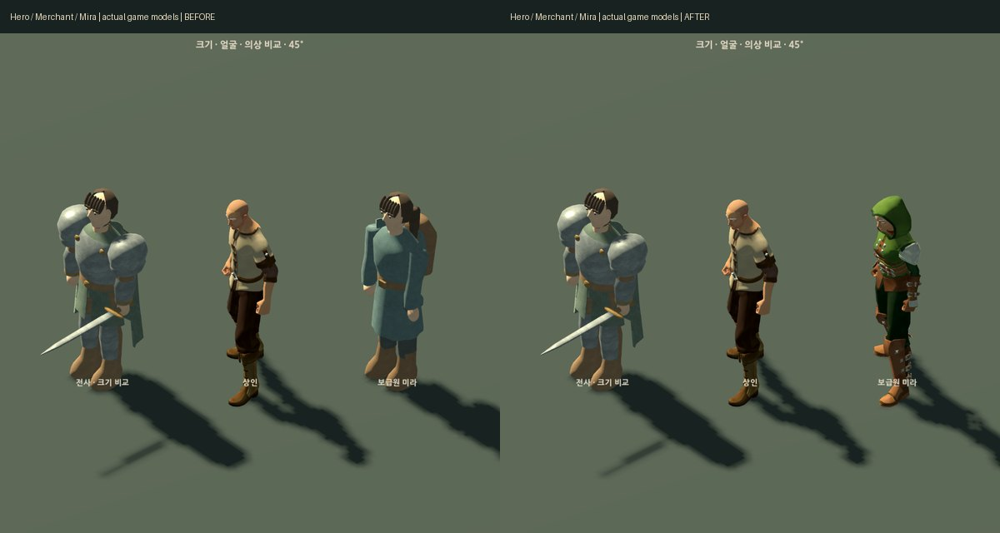
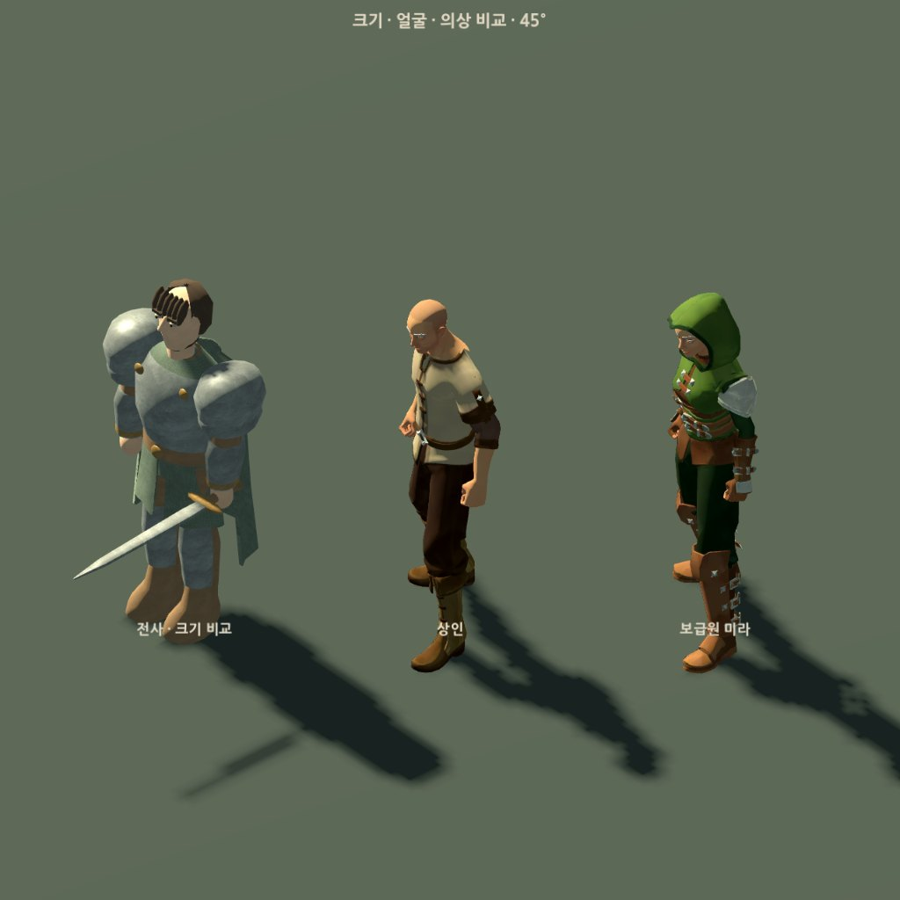
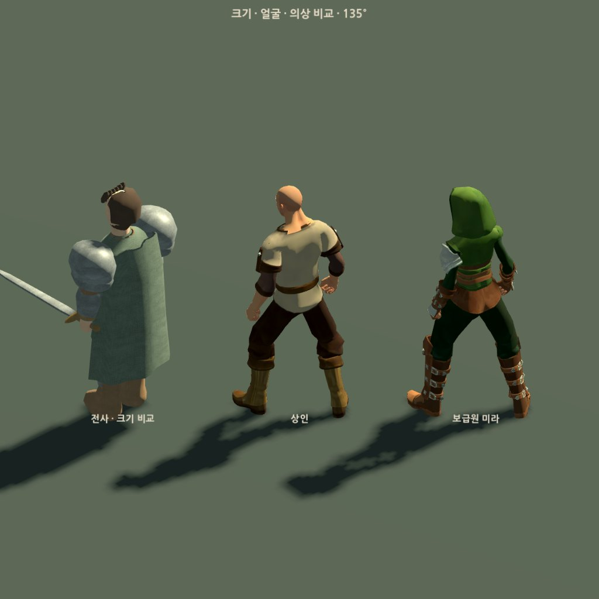
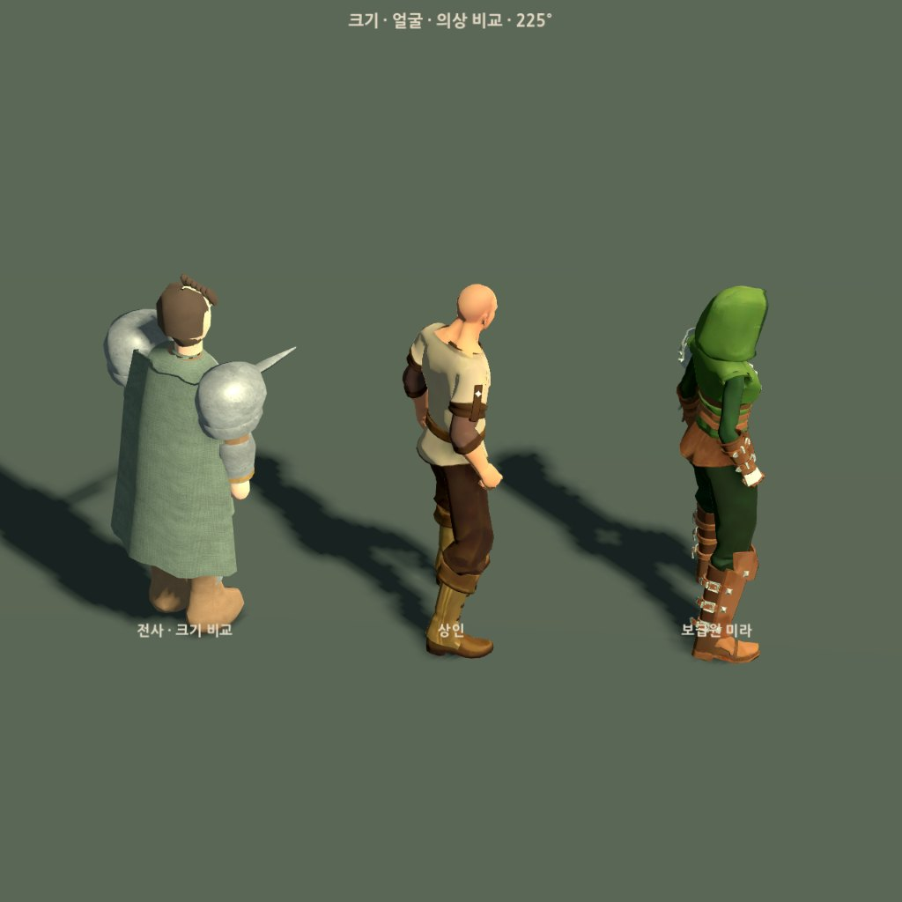
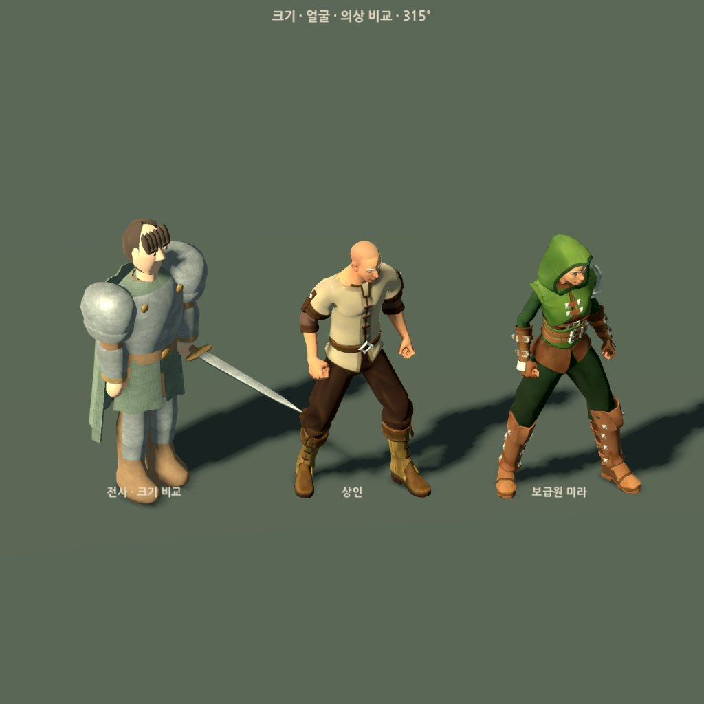
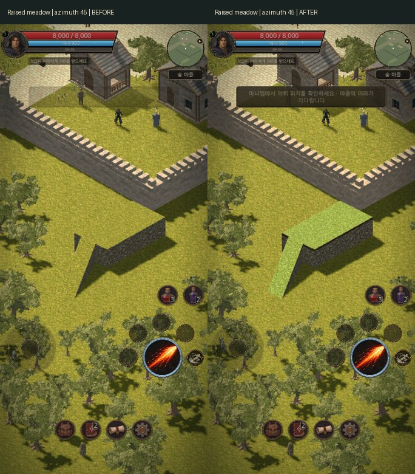

# 마을 에셋 디자인 보기

게임에서 사용하는 실제 3D 모델과 변경 전후 화면입니다. 원본 디자인은 [Quaternius 판타지 의상 팩](https://quaternius.itch.io/modular-character-outfits-fantasy)에서 볼 수 있습니다.

| 대상 | 현재 디자인과 출처 |
| --- | --- |
| 상인 | Quaternius CC0 남성 Peasant, 원래 UV·골격 대기 동작 |
| 보급원 미라 | Quaternius CC0 여성 Ranger와 여성 기본 머리, 후드·어깨 장구·가죽 복장 |
| 나머지 여섯 주민 | 역할별 기존 자체 모델 |
| 전사 | 주민과 크기를 비교하는 기존 주인공 모델 |

[원문 라이선스·취득 해시·실제 제작 기록](../../../sjrpg_3d/docs/native-residents.md)을 함께 보존합니다. 이 페이지의 모델 사진은 실제 게임 factory를 같은 빛과 120° 직교 카메라에서 촬영했습니다. 카메라 방위는 45°·135°·225°·315°, 고도는35.2643897°입니다.

미라 변경 전후입니다. 왼쪽은 이전 모델, 오른쪽은 현재 공개 에셋을 적용한 모델입니다.

네 방향에서 실제 복장·머리·후드와 비율을 확인할 수 있습니다.

높은 잔디 지형은 낮은 곳보다 차가운 세이지색으로 구분합니다. 아래는 같은 카메라와 원래 물리 지형을 유지한 변경 전후입니다.

